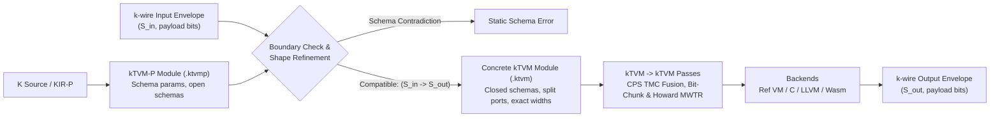

# `kTVM`: Formal Specification and Textual DSL (v0.1)

**Status:** Draft Formal Specification (branch `packed-wire-compiler`)  
**Scope:** Formal abstract machine model, operational semantics, polymorphic schema specialization (`kTVM-P` → `kTVM`), static bit-chunk acceleration contract, and textual DSL grammar for **kTVM** (the K Transducer Virtual Machine).  
**Related Specifications:**
- Wire format contract: [WIRE_FORMAT.md](../codecs/WIRE_FORMAT.md), [prefix-codec.mjs](../codecs/runtime/prefix-codec.mjs)
- Patterns & relations: [PATTERNS.md](PATTERNS.md), [KIR_V1.md](KIR_V1.md)
- Register VM reference: [KVM_EXECUTION_MODEL.md](KVM_EXECUTION_MODEL.md), [POLYMORPHIC_IR.md](POLYMORPHIC_IR.md)
- Empirical foundation: [TRANSDUCER_EXPERIMENT_REPORT.md](TRANSDUCER_EXPERIMENT_REPORT.md)
- Throughput criterion (MWTR): [speed-eval.pdf](speed-eval.pdf)

---

## 1. Design Goals and Compilation Architecture

`kTVM` is a formal, target-independent **streaming pushdown transducer virtual machine** designed to execute K relations directly over unmodified, bit-packed `k-wire` bitstreams without materializing heap-allocated value trees.

Its design rests on five core principles:

1. **Unmodified `k-wire` Boundary Contract:** External inputs and outputs strictly obey [WIRE_FORMAT.md](../codecs/WIRE_FORMAT.md) (`encode(pattern_value) encode(payload)`). Every internal channel carries valid bit-packed `k-wire` payloads with zero per-bit boxing or framing overhead.
2. **Two-Layer Polymorphism (`kTVM-P` → `kTVM`):** Mirrors K's `KIR-P`/`KVM-P` layering. A polymorphic `kTVM-P` module declares schema parameters and open pattern constraints. When a concrete enveloped `k-wire` input arrives at the execution boundary, **input-schema compatibility checking** is unified with **shape refinement**, binding schema parameters, splitting accessed product channels, resolving tag bit-widths, pruning dead branches, and specializing procedures into a concrete monomorphic `kTVM` module.
3. **Two-Tier Execution ISA (Network + Kernel):**
   - The **Network Layer** dynamically instantiates finite transducer DAGs over bit-addressable `BitDeque` channels, supporting lazy demand-driven recursion (`spawn`), bounded-topology branching recursion (`spawn_seq` / `after`), deterministic multi-port switching (`switch`), bit-exact speculative backtracking (`spec`), strict partiality draining (`drain`/`barrier`/`gate`), and $O(1)$ zero-copy graph rewrites (`splice`, `wrap`/`match`, `mux`/`demux` fusion).
   - The **Kernel Layer** executes compiled single-node deterministic state machines, tail-modulo-constructor (TMC) streaming loops, local-register/local-stack automata, and static **variable-width bit-chunk tables** selected under Howard's Minimum Weight-to-Time Ratio (MWTR) criterion.
4. **Formal Soundness by Construction:** Every operational invariant discovered empirically during the V1–V4 transducer prototypes (dual consumer/producer channel schemas, exact value-boundary alignment, upstream-failure vs. local-mismatch separation, strict discarded-input draining, iterative non-recursive pushdown traversal) is encoded directly into the machine state and static validation rules.
5. **Backend & Storage Independence:** The textual DSL (`.ktvmp` / `.ktvm`) is both human-readable and machine-verifiable, serving as the single contract between the K front-end/optimizers and multiple execution targets (JS reference VM, C/LLVM, WebAssembly). The `BitDeque` channel model is encapsulated behind an abstract ADT interface so alternative backing representations can be explored without altering VM semantics.



---

## 2. Schema and Wire Type System

`kTVM` schemas correspond directly to K's regular pattern graphs ([WIRE_FORMAT.md](../codecs/WIRE_FORMAT.md), [PATTERNS.md](PATTERNS.md)), extended with explicit schema parameters for `kTVM-P`.

### 2.1 Schema Algebra

A schema expression $\sigma$ is formed over a finite set of named recursive schema definitions (`schema $Name[$P1, ...] = body`) and schema parameters `$X`:

| Form | K Pattern Node | `k-wire` Bit Representation | Allowed Layer |
| --- | --- | --- | --- |
| `unit` | `closed-product []` | $0$ bits | `kTVM-P`, `kTVM` |
| `product { f1: S1, ..., fm: Sm }` | `closed-product` | Concatenation of `S1 .. Sm` in canonical label order ($0$ framing bits) | `kTVM-P`, `kTVM` |
| `union { t1: S1, ..., tn: Sn }` | `closed-union` | Tag ordinal $i \in [0, n-1]$ MSB-first in $w = \lceil \log_2 n \rceil$ bits ($0$ bits if $n \le 1$), followed by `S_i` | `kTVM-P`, `kTVM` |
| `open_product { f1: S1, ..., ... }` | `open-product` | Concrete layout resolved at specialization or via runtime schema descriptor | `kTVM-P` only |
| `open_union { t1: S1, ..., ... }` | `open-union` | Tag width/ordinal resolved at specialization or via runtime schema descriptor | `kTVM-P` only |
| `any` | `any` | Unconstrained; cannot encode bits without refinement | `kTVM-P` only |
| `$X` | Schema parameter | Instantiated at boundary specialization or passed as DPDA descriptor | `kTVM-P` (or opaque ref) |
| `$Name[A1, ...]` | Named / recursive schema | Regular tree graph (expanded lazily by Moore graph) | `kTVM-P`, `kTVM` |

**Canonical Label Order:** Within any `product` or `union`, labels are unique and sorted strictly in canonical K Unicode code-point order (matching `prefix-codec.mjs`). An empty union `union {}` has no valid values ($\mathcal{L}(\texttt{union \{\}}) = \emptyset$).

### 2.2 Regular-Tree Equivalence (Moore Quotient)

Every closed schema $\sigma$ denotes a finite deterministic tree automaton (property-list graph) $G(\sigma) = (V, E, v_0)$. Two closed schemas $\sigma_1, \sigma_2$ are **wire-equivalent** (written $\sigma_1 \equiv \sigma_2$) iff their **Moore minimal bisimulation quotients** are isomorphic:
- Same node kind (`closed-product` or `closed-union`) at every reachable state pair;
- Identical ordered edge label lists at every reachable state pair;
- Equivalent child target states for every edge.

Because `k-wire` serialization depends *solely* on node kinds and canonical ordered edge lists, $\sigma_1 \equiv \sigma_2 \implies \mathcal{L}(\sigma_1) = \mathcal{L}(\sigma_2)$ bit-for-bit. Consequently, zero-copy `splice` is sound between any two wire-equivalent schemas without inspecting a single payload bit.

### 2.3 Prefix Derivative ($\partial_w \sigma$)

For a closed schema $\sigma$ and a valid bit prefix $w \in \{0,1\}^*$, the **schema derivative** tracks the remaining suffix obligation after emitting $w$:
- For $\sigma = \texttt{union \{ } t_0:\sigma_0, \dots, t_{n-1}:\sigma_{n-1} \texttt{ \}}$ with $w = \mathrm{bits}_{\lceil\log_2 n\rceil}(i)$:
  $$\sigma \xrightarrow{|t_i} \sigma_i$$
- For $\sigma = \texttt{product \{ } f_0:\sigma_0, \dots, f_{m-1}:\sigma_{m-1} \texttt{ \}}$ after emitting complete valid values for fields $f_0 \dots f_{k-1}$:
  $$\sigma \xrightarrow{f_0 \cdots f_{k-1}} \texttt{product \{ } f_k:\sigma_k, \dots, f_{m-1}:\sigma_{m-1} \texttt{ \}}$$
  and specifically after $f_0 \dots f_{m-2}$, the remaining suffix obligation is simply $\sigma_{m-1}$.
- For $\sigma = \texttt{unit}$: emitting $\varepsilon$ completes the value ($\sigma \xrightarrow{\varepsilon} \bot_{\text{done}}$).

---

## 3. Channel Model: `BitDeque` and Dual-Schema Invariant

### 3.1 Abstract Channel ADT (`BitDeque`)

The uniform communication primitive in `kTVM` is a **Single-Producer, Single-Consumer (SPSC)** bit-addressable double-ended queue (`BitDeque`). Each live channel $c$ has abstract state:

$$c = \langle \text{buf} \in \{0,1\}^*,\; \text{status} \in \{\mathsf{OPEN}, \mathsf{CLOSED}, \mathsf{FAILED}\},\; \sigma_{\text{prod}},\; \sigma_{\text{cons}},\; \text{aligned} \in \mathbb{B},\; \text{prod},\; \text{cons},\; \text{scope} \rangle$$

Where:
- `buf`: Unread bit sequence. Producers append at the back (`push_bits`); consumers read/remove from the front (`peek_bits`, `shift_bits`). Prefix constructors, tail-splicers, and speculative rollbacks prepend at the front (`unshift_bits`, `unshift_deque`).
- `status`: Strictly monotone lifecycle:
  $$\mathsf{OPEN} \longrightarrow \mathsf{CLOSED} \qquad \text{or} \qquad \mathsf{OPEN} \longrightarrow \mathsf{FAILED}$$
  Once `CLOSED` or `FAILED`, `status` is immutable and no further producer writes occur.
- `aligned`: `true` iff the consumer has not partially consumed a value from the current $\sigma_{\text{cons}}$ boundary (i.e., `buf` followed by the producer's remaining stream forms a complete value of $\sigma_{\text{cons}}$).
- `prod`, `cons`: Unique owning producer node ID (or `EXT_IN` / `NONE` once closed) and unique owning consumer node ID (or `EXT_OUT`).
- `scope`: Enclosing speculation scope ID (root scope is `0`).

**Required ADT Operations (Complexity Targets):**

| Operation | Signature | Semantics | Target Cost |
| --- | --- | --- | --- |
| `push_bits(c, word, k)` | $k \in [0, 32]$ | Append $k$ LSBs of `word` (MSB-first) to back of `c.buf` | $O(1)$ amortized |
| `unshift_bits(c, word, k)` | $k \in [0, 32]$ | Prepend $k$ LSBs of `word` (MSB-first) to front of `c.buf` | $O(1)$ amortized |
| `peek_bits(c, off, k)` | $k \in [0, 32]$ | Read $k$ bits starting at bit offset `off` from front (non-destructive) | $O(1)$ |
| `shift_bits(c, k)` | $k \in [0, 32]$ | Discard $k$ bits from front of `c.buf` | $O(1)$ |
| `unshift_deque(dst, src)` | $c, c'$ | Prepend all bits of `src.buf` in front of `dst.buf`; empty `src` | $O(|\text{src}| / 32)$ |
| `push_deque(dst, src)` | $c, c'$ | Append all bits of `src.buf` to back of `dst.buf`; empty `src` | $O(|\text{src}| / 32)$ |
| `close(c)` / `fail(c)` | $c$ | Transition `OPEN` → `CLOSED` or `FAILED`; clear `c.prod := NONE` | $O(1)$ |

> **Abstraction Boundary & Production Backing Stores:** Nothing in the operational semantics depends on `BitDeque`'s internal layout. The JS reference VM uses a power-of-2 word ring buffer for simplicity, while the WebAssembly and C/LLVM backends use **segmented fixed-size slabs with a `<= 128b` inline buffer** (zero slab allocation on short-lived streaming FIFOs, zero linear-memory fragmentation, $O(1)$ free-list alloc/rollback, and exact global byte-quota enforcement).

### 3.2 Dual-Schema Suffix Invariant $\mathcal{I}(c)$

Separating consumer schema $\sigma_{\text{cons}}(c)$ from producer suffix schema $\sigma_{\text{prod}}(c)$ is essential whenever a prefix constructor (`wrap |tag`) or partial product emitter (`mux`) emits prefix bits ahead of an upstream producer.

Let $w_{\text{read}}(c) \in \{0,1\}^*$ denote the ghost history of bits already shifted by `c.cons` since the last aligned boundary ($w_{\text{read}}(c) = \varepsilon$ whenever `c.aligned = true`). Every well-formed channel $c$ maintains:

$$\mathcal{I}(c) :\quad \begin{cases}
\forall w_{\text{rem}} \in \mathcal{L}(\sigma_{\text{prod}}(c)).\; w_{\text{read}}(c) \cdot c.\text{buf} \cdot w_{\text{rem}} \in \mathcal{L}(\sigma_{\text{cons}}(c)) & \text{if } c.\text{status} = \mathsf{OPEN} \\
w_{\text{read}}(c) \cdot c.\text{buf} \in \mathcal{L}(\sigma_{\text{cons}}(c)) & \text{if } c.\text{status} = \mathsf{CLOSED}
\end{cases}$$

*(Where if `c.status = CLOSED` and `c.buf` has not yet been fully consumed, `c.prod = NONE`.)*

### 3.3 The Unified `splice(src -> dst)` Primitive

All zero-copy forwarding (`ID`), matched variant stripping (`DIV`), prepend-splicing (`VID`), last-field `MUX` tail-splicing, last-branch `spec` retirement, and compiled-kernel `handoff` reduce to a **single algebraic operation** `splice(src -> dst)`:

**Preconditions:**
1. `src.aligned = true` (the consumer side of `src` is at a fresh value boundary of $\sigma_{\text{cons}}(\text{src})$).
2. $\sigma_{\text{cons}}(\text{src}) \equiv \sigma_{\text{prod}}(\text{dst})$ (the full value produced by `src` matches the remaining suffix obligation of `dst`).
3. `src` and `dst` are in compatible scopes (either same scope, or committing an outer `spec` staging buffer).

**Operational Effect of `splice(src -> dst)`:**
1. **Buffer merge (preserving bit order `dst.buf · src.buf` with minimal copying):**
   - If `|dst.buf| == 0`: `dst` takes ownership of `src.buf` in $O(1)$ (`0` bits copied).
   - Else if `|src.buf| == 0`: keep `dst.buf` (`0` bits copied).
   - Else if `|dst.buf| <= |src.buf|` (the common `wrap |tag` and tail-recursive `cons` case, where `dst` holds a tiny prefix and `src` holds a large tail): execute `unshift_deque(src, dst)` and transfer `src.buf` ownership to `dst` ($O(|\text{dst.buf}|)$ bits moved, **$0$ bits of `src` copied**).
   - Else: execute `push_deque(dst, src)` ($O(|\text{src.buf}|)$ bits moved).
2. **Metadata & Ownership Transfer:**
   - `dst.consSchema` and `dst.aligned` remain **unchanged**!
   - `dst.prodSchema := src.prodSchema` (if `src` is `OPEN`).
   - `dst.status := src.status`.
   - `dst.prod := src.prod` (and if `src.prod != NONE`, rebind that producer's output port handle from `src` to `dst`).
   - Retire channel `src`.

**Corollary (Inductive Preservation of $\mathcal{I}$):**
Since `src` satisfies $\forall w_{\text{rem}} \in \mathcal{L}(\sigma_{\text{prod}}(\text{src})).\; \text{src.buf} \cdot w_{\text{rem}} \in \mathcal{L}(\sigma_{\text{cons}}(\text{src}))$, and $\sigma_{\text{cons}}(\text{src}) \equiv \sigma_{\text{prod}}(\text{dst})$, substituting $\text{src.buf} \cdot w_{\text{rem}}$ into $\mathcal{I}(\text{dst})$ yields:
$$w_{\text{read}}(\text{dst}) \cdot (\text{dst.buf} \cdot \text{src.buf}) \cdot w_{\text{rem}} \in \mathcal{L}(\sigma_{\text{cons}}(\text{dst}))$$
Thus $\mathcal{I}(\text{dst})$ is preserved unconditionally—whether `dst` had a prepended tag (`|+`), a serialized `car` field (`|cons · car`), or a consumer already mid-stream (`aligned = false`).

---

## 4. Polymorphism and Boundary Envelope Specialization (`kTVM-P` → `kTVM`)

K supports parametric polymorphism (e.g., `reverse : list[X] -> list[X]`, `btrie_get : { bits[] key, btrie[V] trie } -> V`) and open structural patterns (`{ X a, ... }`, `< {} nil, ... >`). `kTVM` handles polymorphism in two coordinated stages:

### 4.1 Polymorphic Modules (`kTVM-P`)

A `kTVM-P` module may contain:
- Parameterized schema templates: `schema $list[$X] = union { cons: product { car: $X, cdr: $list[$X] }, nil: unit }`.
- Parameterized procedures: `proc @reverse[$X](%in: $list[$X]) -> (%out: $list[$X])`.
- Open schema positions (`open_product`, `open_union`, `any`) and schema-symbolic instructions (`project .f`, `guard ?$P`, `dpda_copy $X`, `dpda_skip $X`, `dpda_coerce $X -> $Y`).

A `kTVM-P` module is a self-contained polymorphic template; execution always specializes at the input envelope boundary into a **100% closed, envelope-free concrete `kTVM` module** via `specializeKTVM` (backed by K's `intersectPropertyListPatterns`, with an optional `retypeObjectRelationForBackend` pre-pass for non-converged `.ko` relations). If a non-converged relation still cannot close statically, specialization rejects cleanly and the host falls back to `kVM` or the reference evaluator.

### 4.2 Boundary Compatibility Checking and Shape Refinement

When an external `k-wire` input arrives, its header decodes to a closed concrete schema graph $S_{\text{in}}$ ([WIRE_FORMAT.md](../codecs/WIRE_FORMAT.md)). Before decoding payload bits, the boundary driver executes:

$$\mathrm{specialize}(M_P,\; @\text{entry},\; S_{\text{in}}) \;\longrightarrow\; \mathsf{Ok}(M,\; @\text{entry}',\; S_{\text{out}}) \;\mid\; \mathsf{SchemaError}(\text{reason})$$

This pass combines **compatibility verification** and **structural shape refinement** in five steps:

1. **Contract Unification & Parameter Binding:**
   - Unify $S_{\text{in}}$ against `@entry`'s declared input schema contract $C_{\text{in}}$ (using K's greatest-lower-bound / pattern intersection rules from [TYPE_DERIVATION.md](TYPE_DERIVATION.md)).
   - Bind every schema parameter `$X` to a closed concrete sub-schema $S_X$ (checking Moore equivalence whenever `$X` appears multiple times, e.g. `?{ $X a, $X b }`).
   - Refine every `open_product` and `open_union` node by intersecting with the concrete fields/tags present in $S_{\text{in}}$.
   - **Error Semantics:** Any structural contradiction (wrong kind, missing required field, disjoint union tags, incompatible repeated `$X`) raises **`SchemaError`**, strictly distinct from runtime partial failure (`FAILED`).

2. **Output Schema Derivation:**
   - Propagate bound concrete schemas forward through `@entry` and reachable procedures to derive the concrete closed output schema $S_{\text{out}}$ required for the output `k-wire` envelope header.
   - Because K schemas are finite regular graphs, memoizing instantiations by the canonical key `(procId, MooreKey(argSchemas))` is guaranteed to terminate (every encountered sub-schema is either a sub-node of $S_{\text{in}}$, a static pattern node in $M_P$, or a finite intersection thereof).

3. **Access-Profile Port Splitting (Shape Refinement):**
   - For each specialized procedure `@p'`, compute its **access profile** (which product fields are projected, constructed, or passed to callees that project them).
   - **Rule:** If a procedure input or output port has refined to a concrete `product { f1: S1, ..., fm: Sm }` ($m \ge 1$) **and** at least one field of that product is accessed by `@p'` or a callee, split that port into $m$ parallel `BitDeque` channels `(%p.f1: S1, ..., %p.fm: Sm)` (inserting `demux`/`mux` only at union boundaries or the single-stream external `k-wire` boundary).
   - **Opaque Preservation:** If a schema parameter `$X` refined to a concrete product (e.g., `$X := product { a: $int, b: $string }`) in `reverse[$X]`, and `reverse` **never** inspects inside `$X` (only forwards/copies it whole), keep `$X` as a **single `BitDeque`** with concrete schema descriptor `S_X`! This avoids redundant `demux`/`mux` splitting of opaque payloads while still compiling `dpda_copy(S_X)` / `dpda_skip(S_X)` into fast static integer DPDA tables.

4. **Tag Width Resolution, Guard Folding, and Branch Pruning:**
   - Every `open_union` and parameterized `union` now has a fixed canonical tag list, exact ordinal $i$, and exact bit-width $w = \lceil \log_2 n \rceil$.
   - Erase `guard ?$P` instructions proven satisfied by the specialized schema into zero-copy `splice`.
   - Statically prune `switch`/`spec` branches whose leading `match /tag` references a tag absent from the specialized input schema.
   - Collapse `coerce $S1 -> $S2` into zero-copy `splice` whenever $S_1 \equiv S_2$ (Moore-equivalent).
   - Lower `project .f` on split ports into direct channel wiring + `drain` on unused siblings, or on unsplit channels into `demux` + `drain` (or sequential `dpda_skip` + `splice`/`dpda_copy`).

5. **Post-Specialization Kernel & Bit-Chunk Optimization (Optional `kTVM` → `kTVM`):**
   - With all schemas closed and bit-widths exact, the compiler may optionally fuse acyclic subgraphs and self-tail/TMC loops into `kernel` blocks and synthesize `chunk_table`/`stack_table`/`fsm_table` blocks via Howard's MWTR optimizer.

> **Caching & Amortized Cost:** The specialized module `M` is keyed purely by `(moduleHash, entry, MooreKey(S_in))`. Repeated invocations with the same input envelope schema reuse the cached specialized `kTVM` directly with zero re-specialization overhead.

---

## 5. Formal Abstract Machine and Operational Semantics

### 5.1 Machine State $\Sigma$

At runtime, a `kTVM` instance operates over the abstract machine state:

$$\Sigma = \langle N,\; C,\; B,\; S,\; \mathcal{M},\; \text{root\_in},\; \text{root\_out} \rangle$$

Where:
- $\mathcal{M}$ is the immutable loaded `kTVM` module (schemas, DPDA tables, `proc` definitions, `kernel` definitions, static bit-chunk `table`s).
- $N$ is the finite map of active transducer nodes `nid -> NodeState`. Every node carries a `scope: sid`, `status ∈ {ACTIVE, RETIRED}`, and node-kind state.
- $C$ is the finite map of active `BitDeque` channels `cid -> ChannelState`.
- $B$ is the finite map of active partiality barriers `bid -> BarrierState`, where `BarrierState = { guards: Set<cid>, status: PENDING | PASSED | FAILED, waiters: Set<nid> }`.
- $S$ is the tree of active speculation scopes `sid -> ScopeState`, where scope `0` is the root scope, and each child scope `s > 0` records `{ parent: sid, owner: spec_nid, nodes: Set<nid>, chans: Set<cid>, bars: Set<bid>, taps: [(parent_cid, child_cid, replay_buf)], staged: [(child_out_cid, parent_out_cid)] }`.
- `root_in` is the external input `BitDeque` fed from the `k-wire` payload bitstream (`CLOSED` once EOF is reached); `root_out` is the external output `BitDeque` drained to the `k-wire` output bitstream.

### 5.2 Demand-Driven Pull Scheduler & Sequential Settlement

Execution is **demand-driven** from `root_out` (and from the active staging outputs of any active `spec` scope):

1. **Pull Step $\mathsf{pull}(c)$:** Given a channel $c$ whose consumer needs bits (or needs `c.status != OPEN`):
   - If `c.status != OPEN` or `c.prod == NONE`: return immediately (channel is settled or failed).
   - Otherwise, let $u = N[c.\text{prod}]$.
   - **Pre-Expansion Settlement (`after` constraint):** If $u$ is an unexpanded `spawn_node` with an unresolved sequencing dependency `after(v)` where $v \in N$ is still `ACTIVE`, the scheduler first drives $v$ (pulling all of $v$'s output channels to completion/failure until $v$ retires) before expanding $u$.
   - **Step $u$:** Execute one small-step transition of node $u$. If $u$ itself blocks waiting for bits on one of its input channels $c_{\text{in}}$, push $u$ onto the explicit iterative demand stack and call $\mathsf{pull}(c_{\text{in}})$.
   - **Cooperative Yield:** When a streaming `kernel` executes `yield out_q, threshold` (because `|out_q.buf| >= threshold` and `out_q.cons != NONE`), stepping $u$ returns control to `out_q.cons` immediately so downstream drains `out_q` before $u$ resumes.
2. **Termination:** Execution finishes when `root_out.status` becomes `CLOSED` (success: output payload is `root_out.buf`, framed with $S_{\text{out}}$) or `FAILED` (ordinary K partial failure: relation is undefined on this input).
3. **Strict Iterativity:** The VM demand stack and all DPDA traversal stacks MUST be heap-allocated explicit stacks—never host call-stack recursion—so arbitrarily deep `k-wire` structures (e.g., 4,096-bit `bits[]` values) execute without host stack overflow.

### 5.3 Network Layer Instructions & Small-Step Rules

Every `proc` body instantiates a finite acyclic local subgraph when expanded, replacing the `spawn` node in-place inside the same scope.

| Instruction | Signature / Syntax | Small-Step Operational Semantics |
| --- | --- | --- |
| **`chan`** | `chan %c : $S` | Allocate fresh `BitDeque` `%c` in current scope: `buf = ε`, `status = OPEN`, `consSchema = prodSchema = $S`, `aligned = true`. |
| **`barrier`** | `barrier %b` | Allocate barrier `%b` (`guards = ∅`, `status = PENDING`, `waiters = ∅`). |
| **`drain`** | `drain %c : $S [-> %b]` | Register `%c` in `%b.guards` (if `%b` given). Runs iterative `dpda_skip($S)` on `%c`. When `%c` reaches valid end-of-value and `CLOSED`: mark guard done; if all guards of `%b` done, set `%b.status := PASSED` and wake all `%b.waiters`. If `%c` fails or has invalid wire bits: set `%b.status := FAILED`, wake waiters, and retire. |
| **`gate`** | `gate %b, %in -> %out` | Wait until `%b.status != PENDING` (pulling `%b`'s pending guard drains first). If `PASSED`: execute `splice(%in -> %out)` and retire. If `FAILED`: `fail(%out)`, cancel `%in`, and retire. |
| **`splice`** | `splice %in -> %out` | Immediate $O(1)$ rewrite: execute `splice(%in -> %out)` (Section 3.3) and retire. Requires $\sigma_{\text{cons}}(\%in) \equiv \sigma_{\text{prod}}(\%out)$ and `%in.aligned = true`. |
| **`coerce`** | `coerce %in : $S1 -> %out : $S2` | If $S_1 \equiv S_2$, degrade to `splice(%in -> %out)`. Otherwise run iterative paired-stack `dpda_coerce($S1 -> $S2)`: read tag/fields under $S_1$, re-encode under $S_2$, close `%out` on completion (or fail `%out` on `%in` failure / incompatible tag). |
| **`const_unit`** | `const_unit -> %out` | Immediately execute `close(%out)` ($0$ bits written) and retire. Requires $\sigma_{\text{prod}}(\%out) \equiv \texttt{unit}$. |
| **`tee`** | `tee %in -> (%o0, ..., %ok)` | Pull chunks (up to 32 bits) from `%in` and `push_bits` to every non-cancelled `%oj`. On `%in.status == CLOSED` (and `|buf| == 0`): `close` all `%oj` and retire immediately. On `%in.status == FAILED`: `fail` all `%oj` and retire. *(Note: if all consumers fail/cancel except one, `tee` may degrade to `splice`.)* |
| **`wrap`** | `wrap \|tag %in -> %out` | Let `w = code(tag, prodSchema(%out))` of width $k$, with payload schema $\sigma_{\text{tag}}$. Push `w` onto `%out` (`push_bits(%out, w, k)`), narrow `prodSchema(%out) := σ_tag`. If `%in.consSchema ≡ σ_tag`, execute `splice(%in -> %out)` immediately and retire! Otherwise degrade to `coerce %in -> %out`. |
| **`match`** | `match /tag %in -> %out` | Pull until `|%in.buf| >= w` (where $w$ is tag width of `consSchema(%in)`). Peek $w$ bits: if invalid code or `!= code(tag)`, set `fail(%out)`, cancel `%in`, and retire. If equal: `shift_bits(%in, w)`, update `consSchema(%in) := σ_tag` keeping **`%in.aligned := true`** (exact value boundary!), then execute `splice(%in -> %out)` (or `coerce` if schemas differ) and retire! If `%in` is `FAILED` or `CLOSED` with $< w$ bits: `fail(%out)` and retire. |
| **`demux`** | `demux %in : $P -> (f0: %c0, ..., fm: %cm)` | **Fusion Rule:** If `%in.buf == ε`, `%in.aligned == true`, `%in.prod` is a `mux` in the **same scope** with matching product schema `$P` and fields `(f0: %a0, ..., fm: %am)`, then for all $i$: `splice(%ai -> %ci)` and retire both `mux` and `demux` in $O(1)$! **Streaming Rule:** Otherwise, for $i = 0 \dots m-2$ in canonical order, run `dpda_copy(S_i)` from `%in` to `%ci` (closing `%ci` at end of field $i$); after field $m-2$ finishes, `%in` stands at the fresh boundary of `S_{m-1}` (`consSchema := S_{m-1}`, `aligned := true`), so execute **`splice(%in -> %cm)`** (zero-copy final field!) and retire. If `%in` fails at any step, fail all remaining unclosed `%ci` and retire. |
| **`mux`** | `mux (f0: %c0, ..., fm: %cm) -> %out : $P` | **Fusion Rule:** See `demux` above. **Streaming + Tail-Splice Rule:** For $i = 0 \dots m-2$ in canonical order, stream `%ci` to `%out` (`push_bits` / `push_deque`) until `%ci.status == CLOSED` (failing `%out` if any `%ci` fails). Once fields $0 \dots m-2$ are all `CLOSED`, `prodSchema(%out)` has narrowed to `S_{m-1}`: execute **`splice(%cm -> %out)`** and retire! *(Because `splice` prepends small `out.buf` onto large `%cm.buf`, tail-recursive constructors like `{ car, cdr } \|cons` run in $O(|car|)$ with **$0$ bits of `cdr` copied**!)* |
| **`switch`** | `switch (%i0, ...) { case (t0, ...): { body } ... }` | Deterministic prefix-disjoint multi-port branch. Peeks the leading tag code(s) of `%i0, ...` (non-destructively; never shifts bits!). If any inspected `%ij` fails (or closes prematurely), fail all outputs and retire. Once sufficient peek bits exist: if a unique `case` matches, instantiate `body` directly on parent `(in, out)` channels in the current scope and retire `switch`; if none match (and no `default`), fail all outputs and retire. |
| **`spec`** | `spec (%i0, ...) -> (%o0, ...) { branch 0: { ... } ... branch k-1: { ... } }` | Ordered speculative backtracking choice (exact rules in Section 5.4). |
| **`spawn`** | `spawn @proc[$S...](%i...) -> (%o...) [after %tok] [as %tok]` | Allocate an unexpanded lazy stub node in the current scope owning `%o...` and consuming `%i...`. Expands into `@proc`'s body on first pull of any `%oj` (after any `after %tok` peer has retired). Before expanding a recursive `@proc`, the scheduler may settle finite/spliceable upstream chains on `%i...`. |
| **`exec`** | `exec @kernel(%i...) -> (%o...)` | Instantiate a single-node compiled `kernel` in the current scope with initial state `entry`, zeroed local registers, and empty local stacks (Section 5.5). |

**`kTVM-P`-Only Polymorphic Network Instructions** (eliminated during specialization, or executed via runtime schema descriptors):
- `project .f %in : $S -> %out : $Sf`: extracts field `.f` from an `open_product` (draining all other fields via `barrier`).
- `guard ?$P %in -> %out`: verifies/intersects runtime schema against `$P` (`SchemaError` on contradiction; `splice` when satisfied).

### 5.4 Exact Operational Semantics of `spec` (Speculative Choice)

Let `spec (in_0, ..., in_{m-1}) -> (out_0, ..., out_{r-1})` have branches $B_0, \dots, B_{k-1}$ in scope $s_{\text{par}}$:

1. **Empty Choice ($k = 0$):** Immediately `fail(out_l)` for all $l$, cancel inputs, and retire.
2. **Last-Branch Tail Splice ($i = k - 1$):** Instantiate $B_{k-1}$ directly inside $s_{\text{par}}$ wired to the parent `(in_0..in_{m-1})` and `(out_0..out_{r-1})`, and **retire `spec` immediately**. No child scope, replay buffer, or staging buffer is allocated.
3. **Speculative Branch ($i < k - 1$):**
   - Create fresh child scope $s_i$ with `parent = s_par`.
   - For each input $j \in [0, m-1]$, allocate tap channel `in'_j` in $s_i$ backed by a `TAP` producer that pulls from `in_j`, records every bit transferred into `replay_j`, and forwards to `in'_j`.
   - For each output $l \in [0, r-1]$, allocate staging channel `out'_l` in $s_i$ (`consSchema = prodSchema = prodSchema(out_l)`).
   - Instantiate $B_i$ inside $s_i$ connected to `(in'_0..in'_{m-1}) -> (out'_0..out'_{r-1})`.
   - Drive $s_i$ by pulling `out'_0 .. out'_{r-1}` until either:
     - **Case A (All `out'_l` are `CLOSED` — Commit):** Discard all `replay_j`, detach `TAP` nodes (splicing any remaining unread `in'_j` bits back if needed — note: valid K branches drain or consume their inputs cleanly; any still-unread bits in `in'_j` are unshifted back to `in_j` only if unconsumed, otherwise `in_j` advances to the post-branch position), `splice(out'_l -> out_l)` for all $l$, destroy child scope $s_i$, and retire `spec`.
     - **Case B (Some `out'_l` is `FAILED` AND some parent `in_j.status == FAILED` — Upstream Failure Abort):** Destroy child scope $s_i$ (all nodes, channels, barriers in $s_i$), immediately `fail(out_l)` for all $l$, and retire `spec`. **Do NOT try branch $i+1$.**
     - **Case C (Some `out'_l` is `FAILED` AND no parent `in_j` is `FAILED` — Local Mismatch Rollback):** Destroy child scope $s_i$. For every input $j \in [0, m-1]$, restore the parent channel bit-for-bit via `unshift_deque(in_j, replay_j)` (preserving `in_j.consSchema`, `in_j.aligned`, and `in_j.status`). Advance to branch $i + 1$.

*Notice:* If branch $B_i$ diverges (loops forever without closing or failing `out'_l`), Case A/B/C is never reached and $B_{i+1}$ is never tried—preserving exact K branch-order divergence semantics.

### 5.5 Kernel Layer Instructions & Small-Step Rules

A `kernel` is a single transducer node compiled from an acyclic subgraph, a self-tail loop, or a TMC streaming loop. Its local state consists of:
- Input channel handles `%i0 .. %i{m-1}` and output channel handles `%o0 .. %o{r-1}`;
- Current basic-block label `pc` (starts at `entry`);
- Bounded finite-enum registers `reg r : enum(K)` (initialized to `0` or explicit init);
- Optional kernel-local LIFO bit-stacks `stack s : bits` (initially empty; used by virtual-stack kernels like `_lsb_trim`);
- Optional suspended-read state when an input `BitDeque` lacks enough buffered bits and must pull upstream before retrying the current instruction.

| Instruction | Syntax | Operational Semantics |
| --- | --- | --- |
| **`peek_bits`** | `%w = peek_bits %in, @off, k else on_eof` | Ensure `|%in.buf| >= off + k` (pulling `%in` if `OPEN`). If `%in.status == FAILED`, jump to `fail`. If `%in.status == CLOSED` and `|%in.buf| < off + k`, jump to `on_eof`. Else read `k` bits at offset `off` into `%w`. |
| **`shift_bits`** | `shift_bits %in, k` | Discard `k` bits from front of `%in.buf`; sets `%in.aligned := false` unless an explicit schema boundary reset occurs (`shift_tag`). |
| **`shift_tag`** | `shift_tag %in, k -> $S_next` | Discard `k` tag bits from aligned `%in`, updating `consSchema(%in) := $S_next` while keeping `%in.aligned := true`. |
| **`push_bits`** | `push_bits %out, 0b..., k` | Append `k` constant bits to back of `%out.buf`. |
| **`unshift_bits`** | `unshift_bits %out, 0b..., k` | Prepend `k` constant bits onto front of `%out.buf` (requires `%out.aligned == true`). |
| **`set_reg`** | `set_reg r, imm` | Assign integer constant `imm ∈ [0, K-1]` to local register `r`. |
| **`switch_bits`** | `switch_bits %w { case 0b..: goto L ... default: goto Ld }` | Deterministic dispatch on bit temporary `%w`. |
| **`switch_reg`** | `switch_reg r { case 0: goto L ... }` | Deterministic dispatch on finite-enum register `r`. |
| **`stack_push`** | `stack_push s, 0b..., k` | Push `k` bits onto top of local LIFO bit-stack `s`. |
| **`stack_pop`** | `%w = stack_pop s, k else on_empty` | Pop `k` bits from top of `s` into `%w` (or branch to `on_empty` if `|s| < k`). |
| **`stack_clear`** | `stack_clear s` | Discard all bits on local LIFO bit-stack `s` in $O(1)$. |
| **`drain_guard`** | `drain_guard %in : $S` | Run iterative `dpda_skip($S)` to verify `%in` completes cleanly to `CLOSED`; jump to `fail` if `%in` fails or is malformed. (Prevents silent drop of unit/discarded guard failures.) |
| **`dpda_copy`** | `dpda_copy %in -> %out : $S` | Iteratively copy one complete value of schema `$S` from `%in` to `%out`. |
| **`splice`** | `splice %in -> %out` | Transfer `%in` into `%out` via Section 3.3 (kernel relinquishes both handles). |
| **`close`** | `close %out` | Close `%out` (kernel relinquishes `%out`). |
| **`yield`** | `yield %out, N` | If `|%out.buf| >= N` and `%out.cons != NONE`, suspend this kernel and return control to the scheduler so downstream drains `%out`; resume at the next instruction on subsequent pull. |
| **`goto`** | `goto L` | In-place control transfer to basic block `L` ($O(1)$ stack, zero node allocation). |
| **`handoff`** | `handoff @target(%args...) -> (%outs...)` | Replace this kernel in-place with a fresh `spawn @target` (or `exec @target`) on the remaining channels and retire immediately. Valid only when `@target` is wired to remaining outputs. |
| **`retire`** | `retire` | Finish and retire this kernel (validator checks all outputs are closed/spliced/handed off and all inputs are consumed/drained/spliced). |
| **`fail`** | `fail` | Mark every still-owned output channel `FAILED`, cancel owned inputs, and retire. |
| **`table_step`** | `table_step &T, reg_state, (%i...), (%o...) -> exits { 0: L0, ... }` | Execute one or more accelerated multi-bit transitions from `chunk_table &T` (Section 6). |
| **`stack_table_step`** | `stack_table_step &T, reg_state, %in, s, %out -> exits { ... }` | Execute accelerated virtual-stack chunk transitions from `stack_table &T` (Section 6). |
| **`fsm_table_step`** | `fsm_table_step &T, %in, (%o...) -> exits { ... }` | Execute an acyclic multi-bit FSM table lookup from `fsm_table &T` (Section 6). |

---

## 6. Static Bit-Chunk Tables and Howard MWTR Contract

To achieve multi-bit-per-lookup native speed directly over `k-wire`, `kTVM` makes static read-only transition tables first-class module declarations.

### 6.1 Table Kinds

A `kTVM` module may declare three kinds of immutable tables (`table &name ...`):

1. **`chunk_table` (Multi-Port Streaming / TMC Loop Table):**
   - **Header:**
     - `states`: number of abstract FSM/register states $Q$ (mapped from a kernel's `reg_state : enum(Q)`).
     - `inputs`: list of `(port_idx, raw_bits: W_raw, eff_bits: W_eff, compress: none | mask(M) | lut([...]))`.
       - `compress` supports **automatic don't-care bit compression** (e.g., when only `0/1` vs `_` matters, collapsing `W_raw = 12` bits into `W_eff = 6` bits via SWAR `pext`/mask or a tiny LUT, shrinking table size from $2^{12}$ to $2^6$).
     - `outputs`: list of `(port_idx, mode: push | unshift, max_emit_bits)`.
     - `exits`: numbered exit handlers `0 .. E-1`.
   - **Flat Address Space:** Entry index is packed as:
     $$\text{idx} = \bigl(((q \ll W_{\text{eff},0}) \mid \text{compress}_0(\text{peek}_0)) \ll W_{\text{eff},1}\bigr) \mid \dots$$
     (When any input port has $< W_{\text{raw}}$ bits buffered because it reached `CLOSED`, remaining high/low padding positions are filled with a canonical closed-EOF sentinel or routed to a compact fallback/short-buffer kernel path—guaranteeing exact behavior on the final $< W_{\text{raw}}$ bits of every stream without ever misreading padding!)
   - **Entry Payload:** `(kind: CONT | EXIT(e) | FAIL | NEED_MORE, next_q, shift[0..m-1], emit_word[0..r-1], emit_len[0..r-1])`.
   - **Hot Loop Semantics (`table_step`):** On each iteration, if any output has `|out.buf| >= yield_threshold` (with an active consumer), suspend cooperatively and resume at `table_step` on the next pull. Otherwise, for every input port with `< W_raw` bits buffered and `status == OPEN`, pull upstream to refill; if any input is `FAILED`, jump to `fail`; if any input is `CLOSED` with `< W_raw` bits (so a full `W_raw`-bit chunk cannot be formed without EOF padding), jump to `short` (the exact bit-level CFG fallback). Once all inputs hold $\ge W_{\text{raw}}$ bits, execute in-place: peek `W_raw` bits → compress → 1 array lookup → `shift_bits` → `push_bits`/`unshift_bits` → `q := next_q`. On `CONT`, continue the hot loop; on `EXIT(e)`, `NEED_MORE` (→ `short`), or `FAIL` (→ `fail`), transfer control to the mapped basic block!

2. **`stack_table` (Virtual-Stack 1-Stream + 1-LIFO-Stack Loop Table):**
   - Models single-pass streaming automata that maintain a local LIFO bit-stack (e.g., `_lsb_trim`'s deferred-zero tally `z`).
   - **Header:** `states: Q`, `stream_bits: W_s`, `stack_bits: W_k`, `output_mode: push | unshift`, `exits: E`.
   - **Address:** `(q, peek(stream, W_s), stack_top_encoding(s, W_k))` where `stack_top_encoding` encodes both the available stack depth $\min(|s|, W_k)$ and the top bits so empty-stack vs. non-empty-stack transitions are resolved in a single lookup.
   - **Entry Payload:** `(kind, next_q, shift_stream, pop_stack, push_stack_word, push_stack_len, emit_word, emit_len)`.

3. **`fsm_table` (Acyclic & Cross-Schema Finite Transducer Table):**
   - Compiles acyclic multi-step helpers (including heterogeneous cross-schema transitions such as `int[] -> bits[]`, `_classify_bits`, `_drop16`) into 1 or a few lookups consuming up to `W_raw` bits at once, followed by `EXIT(e)` to emit/splice/handoff.

### 6.2 Verification & MWTR Optimization Contract

Every `table` declaration may carry optional metadata:
- `verified_against: @kernel_name` — asserts that the table is **bisimulation-equivalent** to the reference un-chunked `kernel` CFG over all valid `k-wire` inputs. In production compilation, static bisimulation verification is **enabled by default** (with an explicit opt-out flag for oversized tables), catching optimizer defects before code generation.
- `mwtr: { rho: <float>, bytes: <int>, budget_class: "L1" | "L2" | ... }` — records the worst-case asymptotic bits-per-lookup ratio $\rho^*$ computed by **Howard's policy-improvement algorithm** ([speed-eval.pdf](speed-eval.pdf)) over the table's strongly connected transition graph (with cycle weight = bits shifted, cycle time = lookups, accounting for amortized stack pops in `stack_table`), together with its static byte footprint. Default global budget is **`64 KB` (L1-resident)**, configurable via CLI/API, with graceful fallback to un-chunked `kernel` CFG on wide alphabets (`ascii[]`/`unicode[]` in `lib/djson.k`).

---

## 7. Formal Soundness Properties

A valid `kTVM` module (Section 8) executed under Section 5 satisfies four structural guarantees:

1. **SPSC Linearity & Dual-Schema Soundness:** Every channel has at most one producer and at most one consumer at all times, and every operational step preserves $\mathcal{I}(c)$ (Section 3.2). No producer ever writes invalid tag ordinals or clobbers an already-prepended consumer schema.
2. **Dynamic DAG Acyclicity & Deadlock Freedom:**
   - Every `proc` body is statically acyclic (checked by validator); recursion only extends the network forward through fresh `spawn` nodes.
   - Every `after %tok` constraint connects only data-independent siblings within the same `proc` expansion (no channel path may exist from the `after` target's outputs back to the `after` predecessor's inputs).
   - Because `BitDeque` buffers grow dynamically (no bounded-buffer write blocking on `tee` or `mux`), no cyclic wait can form between any set of active nodes. Every live network snapshot is a finite DAG, so the pull scheduler is **provably deadlock-free**.
3. **Exact K Partiality & Branch-Order Fidelity:**
   - Every unread input channel must be explicitly attached to a `drain` node linked to a `barrier` gating sibling outputs (checked by validator). Thus discarded computations cannot fail silently.
   - `spec` evaluates branches sequentially in source order, aborts immediately on upstream input failure without rolling back, and never falls through past a diverging earlier branch.
4. **Bit-Exact `k-wire` Equivalence:** For any closed `k-wire` input $(S_{\text{in}}, b_{\text{in}})$ compatible with `@entry`, `kTVM` produces $(S_{\text{out}}, b_{\text{out}})$ (or `FAILED`, or diverges) identically to K's reference operational semantics under `prefix-codec.mjs`.

---

## 8. Static Validation Rules

Before executing or lowering a `kTVM` (or `kTVM-P`) module, the validator verifies:

1. **Schema Well-Formedness:** All schema references resolve; labels within each `product`/`union` are unique and in canonical order; no unguarded direct cycle `schema $A = $A`; concrete `kTVM` modules contain zero `open_product`, `open_union`, `any`, or unbound `$X` nodes.
2. **SPSC Channel Linearity:** Within every `proc` body (and each branch of `switch`/`spec`), every local `chan` has exactly one producer and exactly one consumer; every input port is consumed exactly once (via instruction, `tee`, `splice`, `drain`, or `spawn`); every output port is produced exactly once.
3. **Local Acyclicity:** The channel dependency graph + `after` scheduling edges within each `proc` body is a DAG.
4. **Schema & Alignment Typing:** Every `splice`, `wrap`, `match`, `mux`, `demux`, `spawn`, and `exec` matches the declared schemas (up to Moore equivalence $\equiv$ in `kTVM`, or unify-compatible in `kTVM-P`).
5. **Kernel Discipline:** Every path through a `kernel` terminates at `retire`, `handoff`, `fail`, or a `goto` cycle; `retire` is reachable only when all owned outputs have been closed/spliced and all owned inputs consumed/drained/spliced; `unshift_bits` occurs only on statically aligned outputs.
6. **Optional Table Bisimulation Check:** For every `table` with `verified_against: @k`, symbolically simulate each table entry against `@k`'s CFG and confirm identical state transitions, shift counts, emitted bits, and exit labels.

---

## 9. Concrete Textual DSL Grammar (EBNF)

File extensions: `.ktvmp` (`kTVM-P` polymorphic template), `.ktvm` (`kTVM` specialized executable module). Comments follow K conventions (`-- ...`, `// ...`, `/* ... */`).

**Dual Canonical Format:** `kTVM` supports one shared AST with two lossless 1-to-1 serializations: (1) this human-readable textual DSL (using `packed_base64` for large static tables) as the primary authoring and testing format, and (2) a JSON artifact (`format: "k-tvm"`, `version: 1`) matching `KIR-P`/`kVM` conventions for `backend-api.mjs` and specialization caches.

```ebnf
module        ::= header decl* EOF ;

header        ::= "ktvm" version layer_kind ("entry" PROC_ID)? ";" ;
version       ::= INT "." INT ;
layer_kind    ::= "poly" | "mono" ;

decl          ::= schema_decl
                | proc_decl
                | kernel_decl
                | table_decl ;

(* --- Schemas --- *)
schema_decl   ::= "schema" SCHEMA_ID schema_params? "=" schema_expr ";" ;
schema_params ::= "[" SCHEMA_ID ("," SCHEMA_ID)* "]" ;

schema_expr   ::= "unit"
                | "any"
                | "product" "{" field_spec_list? "}"
                | "open_product" "{" field_spec_list? "..." "}"
                | "union" "{" field_spec_list? "}"
                | "open_union" "{" field_spec_list? "..." "}"
                | SCHEMA_ID ("[" schema_expr ("," schema_expr)* "]")? ;

field_spec_list ::= label ":" schema_expr ("," label ":" schema_expr)* (",")? ;

(* --- Network Procedures --- *)
proc_decl     ::= "proc" PROC_ID schema_params? "(" port_list? ")" "->" "(" port_list? ")"
                  proc_attr* "{" net_stmt* "}" ;
proc_attr     ::= "acyclic" | "branching" | "total" ;
port_list     ::= port_decl ("," port_decl)* ;
port_decl     ::= VAR_ID ":" schema_expr ;

net_stmt      ::= "chan" VAR_ID ":" schema_expr ";"
                | "barrier" VAR_ID ";"
                | "drain" VAR_ID ":" schema_expr ("->" VAR_ID)? ";"
                | "gate" VAR_ID "," VAR_ID "->" VAR_ID ";"
                | "splice" VAR_ID "->" VAR_ID ";"
                | "coerce" VAR_ID ":" schema_expr "->" VAR_ID ":" schema_expr ";"
                | "const_unit" "->" VAR_ID ";"
                | "tee" VAR_ID "->" "(" var_list ")" ";"
                | "wrap" "|" label VAR_ID "->" VAR_ID ";"
                | "match" "/" label VAR_ID "->" VAR_ID ";"
                | "demux" VAR_ID ":" schema_expr "->" "(" labeled_vars? ")" ";"
                | "mux" "(" labeled_vars? ")" "->" VAR_ID ":" schema_expr ";"
                | "project" "." label VAR_ID ":" schema_expr "->" VAR_ID ":" schema_expr ";"
                | "guard" "?" schema_expr VAR_ID "->" VAR_ID ";"
                | "spawn" PROC_ID schema_args? "(" var_list? ")" "->" "(" var_list? ")"
                    ("after" VAR_ID)? ("as" VAR_ID)? ";"
                | "exec" PROC_ID "(" var_list? ")" "->" "(" var_list? ")" ";"
                | switch_stmt
                | spec_stmt ;

schema_args   ::= "[" schema_expr ("," schema_expr)* "]" ;
var_list      ::= VAR_ID ("," VAR_ID)* ;
labeled_vars  ::= label ":" VAR_ID ("," label ":" VAR_ID)* ;

switch_stmt   ::= "switch" "(" var_list ")" "{" switch_arm+ ("default" ":" "{" net_stmt* "}")? "}" ;
switch_arm    ::= "case" "(" pat_tag ("," pat_tag)* ")" ":" "{" net_stmt* "}" ;
pat_tag       ::= "/" label | "_" ;

spec_stmt     ::= "spec" "(" var_list? ")" "->" "(" var_list? ")" "{" spec_branch* "}" ;
spec_branch   ::= "branch" INT ":" "{" net_stmt* "}" ;

(* --- Compiled Kernels --- *)
kernel_decl   ::= "kernel" PROC_ID "(" port_list? ")" "->" "(" port_list? ")"
                  kernel_attr* "{" kernel_res* kernel_block+ "}" ;
kernel_attr   ::= "total" | "tmc" ;

kernel_res    ::= "reg" IDENT ":" "enum" "(" INT ")" ("=" INT)? ";"
                | "stack" IDENT ":" "bits" ";" ;

kernel_block  ::= IDENT ":" kernel_stmt* kernel_term ;

kernel_stmt   ::= VAR_ID "=" "peek_bits" VAR_ID "," "@" INT "," INT "else" IDENT ";"
                | "shift_bits" VAR_ID "," INT ";"
                | "shift_tag" VAR_ID "," INT "->" schema_expr ";"
                | "push_bits" VAR_ID "," BITS_LIT "," INT ";"
                | "unshift_bits" VAR_ID "," BITS_LIT "," INT ";"
                | "set_reg" IDENT "," INT ";"
                | "stack_push" IDENT "," BITS_LIT "," INT ";"
                | VAR_ID "=" "stack_pop" IDENT "," INT "else" IDENT ";"
                | "stack_clear" IDENT ";"
                | "drain_guard" VAR_ID ":" schema_expr ";"
                | "dpda_copy" VAR_ID "->" VAR_ID ":" schema_expr ";"
                | "dpda_coerce" VAR_ID ":" schema_expr "->" VAR_ID ":" schema_expr ";"
                | "splice" VAR_ID "->" VAR_ID ";"
                | "close" VAR_ID ";"
                | "yield" VAR_ID "," INT ";" ;

kernel_term   ::= "goto" IDENT ";"
                | "retire" ";"
                | "fail" ";"
                | "handoff" PROC_ID "(" var_list? ")" "->" "(" var_list? ")" ";"
                | "switch_bits" VAR_ID "{" bit_case+ ("default" ":" "goto" IDENT ";")? "}"
                | "switch_reg" IDENT "{" int_case+ "}"
                | "table_step" TABLE_ID "," IDENT "," "(" var_list ")" "," "(" var_list? ")"
                    "->" "exits" "{" exit_map "}" ";"
                | "stack_table_step" TABLE_ID "," IDENT "," VAR_ID "," IDENT "," VAR_ID
                    "->" "exits" "{" exit_map "}" ";"
                | "fsm_table_step" TABLE_ID "," VAR_ID "," "(" var_list? ")"
                    "->" "exits" "{" exit_map "}" ";" ;

bit_case      ::= "case" BITS_LIT ":" "goto" IDENT ";" ;
int_case      ::= "case" INT ":" "goto" IDENT ";" ;
exit_map      ::= exit_entry ("," exit_entry)* (",")? ;
exit_entry    ::= (INT | "short" | "fail") ":" IDENT ;

(* --- Static Bit-Chunk Tables --- *)
table_decl    ::= "table" TABLE_ID table_kind "{" table_prop* table_entries "}" ;
table_kind    ::= "chunk_table" | "stack_table" | "fsm_table" ;
table_prop    ::= IDENT ":" table_val ";" ;
table_val     ::= INT | FLOAT | STRING | IDENT | PROC_ID
                | "[" (table_val ("," table_val)*)? "]"
                | "{" (IDENT ":" table_val ("," IDENT ":" table_val)*)? "}" ;
table_entries ::= "entries" "{" entry_row* "}"
                | "packed_base64" STRING ";" ;
entry_row     ::= INT "=>" table_val ";" ;

(* --- Lexical Tokens --- *)
SCHEMA_ID     ::= "$" IDENT ;
PROC_ID       ::= "@" IDENT ;
TABLE_ID      ::= "&" IDENT ;
VAR_ID        ::= "%" IDENT ;
BITS_LIT      ::= "0b" ("0" | "1")+ ;
label         ::= IDENT | INT | "+" | "-" | STRING ;
IDENT         ::= [A-Za-z_] [A-Za-z0-9_?'-]* ;
INT           ::= [0-9]+ ;
FLOAT         ::= [0-9]+ "." [0-9]+ ;
STRING        ::= "\"" ([^"\\] | "\\" .)* "\"" ;
```

---

## 10. Worked End-to-End Examples

### 10.1 Polymorphism & Boundary Specialization: `reverse` (`lib/generic.k`)

**Source K (`lib/generic.k`):**
```k
list[X]  = < {} nil, { X car, L cdr } cons > = L;
reverse  = ?list[X] { () xs, {} |nil acc } _reverse ?list[X];
_reverse = ?{ list[X] xs, list[X] acc } <
  { .xs /nil _, .acc acc } .acc,
  { .xs /cons .cdr xs, { .xs /cons .car car, .acc cdr } |cons acc } _reverse
>;
```

**Stage 1 — Polymorphic `kTVM-P` Module (`reverse.ktvmp`):**
```ktvm
ktvm 0.1 poly entry @reverse;

schema $list[$X] = union {
  cons: product { car: $X, cdr: $list[$X] },
  nil:  unit
};

proc @reverse[$X](%in: $list[$X]) -> (%out: $list[$X]) {
  chan %acc_u : unit;
  chan %acc   : $list[$X];
  const_unit -> %acc_u;
  wrap |nil %acc_u -> %acc;
  spawn @_reverse[$X](%in, %acc) -> (%out);
}

proc @_reverse[$X](%xs: $list[$X], %acc: $list[$X]) -> (%out: $list[$X]) {
  switch (%xs) {
    case (/nil): {
      chan %u : unit;
      barrier %b;
      match /nil %xs -> %u;
      drain %u : unit -> %b;
      gate %b, %acc -> %out;
    }
    case (/cons): {
      chan %cell    : product { car: $X, cdr: $list[$X] };
      chan %car     : $X;
      chan %cdr     : $list[$X];
      chan %newcell : product { car: $X, cdr: $list[$X] };
      chan %newacc  : $list[$X];
      match /cons %xs -> %cell;
      demux %cell : product { car: $X, cdr: $list[$X] } -> (car: %car, cdr: %cdr);
      mux (car: %car, cdr: %acc) -> %newcell : product { car: $X, cdr: $list[$X] };
      wrap |cons %newcell -> %newacc;
      spawn @_reverse[$X](%cdr, %newacc) -> (%out);
    }
  }
}
```

**Stage 2 — Boundary Specialization when an enveloped `list[int[]]` arrives (`reverse_int.ktvm`):**
Suppose the input envelope supplies `S_in = $list[$int]`. Boundary refinement checks compatibility against `$list[$X]`, binds `$X := $int`, derives `S_out = $list[$int]`, and notices:
- `cons` is accessed (`demux`/`mux`), so `cons` splits into `(%car: $int, %cdr: $list[$int])`.
- `$int` itself is **never** projected or matched inside `@reverse`, so `%car` stays a **single opaque `BitDeque`** of schema `$int`, and `demux` copies `car` with a compiled concrete `dpda_copy($int)` while `mux` tail-splices `%acc` in $O(1)$ (`0` bits of `%acc` copied per element)!
- Tag bit-widths resolve statically: `cons = 0b0` (1 bit), `nil = 0b1` (1 bit).

```ktvm
ktvm 0.1 mono entry @reverse__int;

schema $bits = union { 0: $bits, 1: $bits, _: unit };
schema $int  = union { "+": $bits, "-": $bits };
schema $list_int = union {
  cons: product { car: $int, cdr: $list_int },
  nil:  unit
};

proc @reverse__int(%in: $list_int) -> (%out: $list_int) total {
  chan %acc_u : unit;
  chan %acc   : $list_int;
  const_unit -> %acc_u;
  wrap |nil %acc_u -> %acc;          // pushes 1 bit (0b1), closes %acc
  spawn @_reverse__int(%in, %acc) -> (%out);
}

proc @_reverse__int(%xs: $list_int, %acc: $list_int) -> (%out: $list_int) total {
  switch (%xs) {                     // 1-bit peek: 0 -> cons, 1 -> nil
    case (/nil): {
      chan %u : unit;
      barrier %b;
      match /nil %xs -> %u;
      drain %u : unit -> %b;
      gate %b, %acc -> %out;         // O(1) splice of reversed %acc
    }
    case (/cons): {
      chan %cell    : product { car: $int, cdr: $list_int };
      chan %car     : $int;          // stays opaque single BitDeque!
      chan %cdr     : $list_int;
      chan %newcell : product { car: $int, cdr: $list_int };
      chan %newacc  : $list_int;
      match /cons %xs -> %cell;
      demux %cell : product { car: $int, cdr: $list_int } -> (car: %car, cdr: %cdr);
      mux (car: %car, cdr: %acc) -> %newcell : product { car: $int, cdr: $list_int };
      wrap |cons %newcell -> %newacc; // O(1) unshift of (0b0 + car) onto %acc
      spawn @_reverse__int(%cdr, %newacc) -> (%out);
    }
  }
}
```

### 10.2 Guarded Streaming TMC Kernel + Bit-Chunk Table: `_lsb_add` (`integer-streaming.k`)

Demonstrates in-register carry promotion (`reg c : enum(2)`), forward streaming `push_bits`, cooperative `yield`, $O(1)$ zero-copy tail splicing on `carry == 0`, and accelerated `chunk_table` dispatch with short-tail fallback to the exact bit-level CFG:

```ktvm
ktvm 0.1 mono entry @lsb_add;

schema $bits = union { 0: $bits, 1: $bits, _: unit };
// Canonical tag codes: 0 -> 0b00, 1 -> 0b01, _ -> 0b10 (0b11 invalid)

proc @lsb_add(%x: $bits, %y: $bits) -> (%out: $bits) total {
  exec @_lsb_add_kernel(%x, %y) -> (%out);
}

kernel @_lsb_add_kernel(%x: $bits, %y: $bits) -> (%out: $bits) total tmc {
  reg c : enum(2) = 0;

  entry:
    yield %out, 64;
    table_step &tab_lsb_add, c, (%x, %y), (%out) -> exits {
      short: slow_step,
      0:     exit_zero_done,
      1:     exit_carry_done,
      2:     exit_splice_y,
      3:     exit_splice_x,
      fail:  err
    };

  slow_step:
    %tx = peek_bits %x, @0, 2 else err;
    %ty = peek_bits %y, @0, 2 else err;
    switch_bits %tx {
      case 0b10: goto x_end;
      case 0b00: goto x_0;
      case 0b01: goto x_1;
      default:   goto err;
    }

  x_end:
    switch_bits %ty {
      case 0b10: goto both_end;
      case 0b00: goto x_end_y_nz;
      case 0b01: goto x_end_y_nz;
      default:   goto err;
    }

  both_end:
    shift_tag %x, 2 -> unit;
    shift_tag %y, 2 -> unit;
    drain_guard %x : unit;
    drain_guard %y : unit;
    switch_reg c {
      case 0: goto exit_zero_done;
      case 1: goto exit_carry_done;
    }

  x_end_y_nz:
    switch_reg c {
      case 0: goto x_end_splice_y;
      case 1: goto x_end_prop_carry;
    }

  x_end_splice_y:
    shift_tag %x, 2 -> unit;
    drain_guard %x : unit;
    goto exit_splice_y;

  x_end_prop_carry:
    // y_bit + carry=1: 0+1 -> emit 1, c=0; 1+1 -> emit 0, c=1
    shift_tag %y, 2 -> $bits;
    switch_bits %ty {
      case 0b00: goto emit_1_c0;
      case 0b01: goto emit_0_c1;
      default:   goto err;
    }

  // (x_0, x_1 symmetric full-adder states omitted for brevity;
  //  each shifts consumed tags, pushes sum tag to %out, updates c, goto entry)
  x_0:
    goto err;
  x_1:
    goto err;

  emit_1_c0:
    push_bits %out, 0b01, 2;
    set_reg c, 0;
    goto entry;

  emit_0_c1:
    push_bits %out, 0b00, 2;
    set_reg c, 1;
    goto entry;

  exit_zero_done:
    push_bits %out, 0b10, 2;         // emit '_'
    close %out;
    retire;

  exit_carry_done:
    push_bits %out, 0b01, 2;         // emit '1'
    push_bits %out, 0b10, 2;         // emit '_'
    close %out;
    retire;

  exit_splice_y:
    splice %y -> %out;               // O(1) zero-copy tail splice!
    retire;

  exit_splice_x:
    splice %x -> %out;               // O(1) zero-copy tail splice!
    retire;

  err:
    fail;
}

table &tab_lsb_add chunk_table {
  states: 2;
  inputs: [
    { port: 0, raw_bits: 8, eff_bits: 8, compress: none },
    { port: 1, raw_bits: 8, eff_bits: 8, compress: none }
  ];
  outputs: [ { port: 0, mode: push, max_emit_bits: 10 } ];
  verified_against: @_lsb_add_kernel;
  mwtr: { rho: 16.0, bytes: 196608, budget_class: "L2" };
  packed_base64 "AAA=";              // placeholder in spec example
}
```

### 10.3 Virtual-Stack Kernel: Online `_lsb_trim` (`integer-streaming.k`)

Demonstrates a first-class kernel-local LIFO bit-stack (`stack z : bits`) accelerating single-pass trailing-zero trimming without an external `BitDeque` channel:

```ktvm
kernel @_lsb_trim_kernel(%in: $bits) -> (%out: $bits) total tmc {
  reg mode : enum(2) = 0;            // 0 = scan, 1 = flush deferred '0's
  stack z  : bits;                   // local LIFO tally of pending '0' tags

  entry:
    yield %out, 64;
    stack_table_step &tab_lsb_trim, mode, %in, z, %out -> exits {
      short: slow_step,
      0:     exit_eof,
      fail:  err
    };

  slow_step:
    switch_reg mode {
      case 0: goto scan;
      case 1: goto flush;
    }

  scan:
    %t = peek_bits %in, @0, 2 else err;
    switch_bits %t {
      case 0b10: goto scan_eof;      // '_': drop all deferred '0's in z!
      case 0b00: goto scan_zero;     // '0': defer onto local stack z
      case 0b01: goto scan_one;      // '1': flush z then emit '1'
      default:   goto err;
    }

  scan_eof:
    shift_tag %in, 2 -> unit;
    drain_guard %in : unit;
    stack_clear z;
    goto exit_eof;

  scan_zero:
    shift_tag %in, 2 -> $bits;
    stack_push z, 0b0, 1;
    goto entry;

  scan_one:
    shift_tag %in, 2 -> $bits;
    %_top = stack_pop z, 1 else emit_one_scan;
    push_bits %out, 0b00, 2;
    set_reg mode, 1;
    goto entry;

  flush:
    %_top = stack_pop z, 1 else emit_one_scan;
    push_bits %out, 0b00, 2;
    goto entry;

  emit_one_scan:
    push_bits %out, 0b01, 2;
    set_reg mode, 0;
    goto entry;

  exit_eof:
    push_bits %out, 0b10, 2;
    close %out;
    retire;

  err:
    fail;
}
```

### 10.4 Branching Recursion with Sequential Sibling Settlement: Karatsuba `lsb_mul`

Demonstrates explicit `after %tok` sequencing on the 3 branching recursive `lsb_mul` calls (derived statically from `isBranchingRecursive`), keeping peak live network topology $O(\log n)$ instead of $O(n^{\log_2 3})$ while preserving textbook non-tail recursion:

```ktvm
proc @lsb_mul_karatsuba(%x: $bits, %y: $bits) -> (%out: $bits) branching total {
  chan %x0 : $bits;  chan %x1 : $bits;
  chan %y0 : $bits;  chan %y1 : $bits;
  chan %k  : $bits;  chan %k0 : $bits;  chan %k1 : $bits;  chan %k2 : $bits;
  chan %xlo : $bits; chan %xhi : $bits;
  chan %ylo : $bits; chan %yhi : $bits;
  chan %xlo0 : $bits; chan %xlo1 : $bits; chan %xhi0 : $bits; chan %xhi1 : $bits;
  chan %ylo0 : $bits; chan %ylo1 : $bits; chan %yhi0 : $bits; chan %yhi1 : $bits;
  chan %sx : $bits;  chan %sy : $bits;
  chan %z0 : $bits;  chan %z2 : $bits;  chan %z3 : $bits;

  tee %x -> (%x0, %x1);
  tee %y -> (%y0, %y1);
  spawn @half_max_tally(%x0, %y0) -> (%k);
  tee %k -> (%k0, %k1, %k2);

  spawn @lsb_split(%x1, %k0) -> (%xlo, %xhi);
  spawn @lsb_split(%y1, %k1) -> (%ylo, %yhi);

  tee %xlo -> (%xlo0, %xlo1);
  tee %xhi -> (%xhi0, %xhi1);
  tee %ylo -> (%ylo0, %ylo1);
  tee %yhi -> (%yhi0, %yhi1);

  spawn @lsb_add(%xlo1, %xhi1) -> (%sx);
  spawn @lsb_add(%ylo1, %yhi1) -> (%sy);

  // Sequential sibling settlement: each recursive subtree retires into a plain
  // BitDeque before the next expands -> O(log n) peak live nodes!
  spawn @lsb_mul(%xlo0, %ylo0) -> (%z0) as %t0;
  spawn @lsb_mul(%xhi0, %yhi0) -> (%z2) after %t0 as %t1;
  spawn @lsb_mul(%sx,   %sy)   -> (%z3) after %t1;

  spawn @_karatsuba_combine(%k2, %z0, %z2, %z3) -> (%out);
}
```

---

## 11. Implementation Roadmap and Evolution Hooks

### 11.1 Production Milestones (`k/ktvm/`, Peer Backend Alongside `kVM`)

1. **Milestone 1 — Standalone `kTVM` Core & Iterative Reference VM (`k/ktvm/`):**
   - `ast.mjs`, `parser.mjs`, `printer.mjs`, `json.mjs`: round-trip `.ktvmp`/`.ktvm` DSL + `format: "k-tvm"` JSON export.
   - `schema.mjs`: Moore quotient minimization, prefix derivatives, and bridge to K's `intersectPropertyListPatterns`.
   - `validator.mjs`: enforces all 6 static validation rules (Section 8)—including SPSC linearity, `(prodSchema, consSchema)` checking, DAG acyclicity, and always-on table-to-`CFG` bisimulation verification.
   - `bit-deque.mjs`: power-of-2 ring-buffer `BitDeque` ADT with configurable byte quotas (`maxBitDequeBytes`).
   - `specialize.mjs`: standalone `specializeKTVM(ktvmp, entry, S_in)` → `SchemaError` or concrete envelope-free `.ktvm` + `S_out`.
   - `vm.mjs`: strictly iterative small-step reference interpreter + iterative `k-wire` boundary codec + runtime quotas (`maxBitDequeBytes`, `maxNodes`, `maxSteps`).
   - Standalone tests covering all 4 worked examples (Section 10), partiality (`barrier`/`gate`), `spec` rollback/upstream-abort, `tee`, quotas, and malformed wire hardening.
2. **Milestone 2 — `KIR-P → kTVM-P` Lowering & Full K Parity:**
   - `lower-kir.mjs`: lower all `KIR-P` opcodes (`usedPaths`, deterministic `switch` vs. `spec`, `isBranchingRecursive` `after %tok`, optional `retypeObjectRelationForBackend` fallback).
   - Integrate into `backend-api.mjs`, `harness/cli.mjs`, and `npm test` while keeping `k/lib/*.k` untouched.
   - Pass 100% parity on `npm run conformance`, `lib/generic.k`, `lib/integer.k`, `lib/ieee.k`, `lib/djson.k`, and `integer-streaming.k`, plus differential fuzzing.
3. **Milestone 3 — Verified `kTVM → kTVM` Optimization Passes (`k/ktvm/optimize/`):**
   - CPS symbolic `kernel` fusion & TMC forward streaming (register & local LIFO `stack` promotion).
   - Bit-chunk / stack-chunk / heterogeneous FSM table synthesis (`SWAR` compression, `64 KB` default L1 Howard `MWTR` budget, graceful wide-alphabet `CFG` fallback, always-on bisimulation verification).
4. **Milestone 4 — WebAssembly Backend (`k/ktvm/wasm/`) & C/LLVM Follow-Up:**
   - Lower concrete `.ktvm` to WAT/Wasm via `wabt`: flat active-node slab pool, `<= 128b`-inline + segmented-slab `BitDeque`s with global quota, static data segments for chunk tables, and iterative worklist pull scheduler.
   - Benchmark head-to-head against `main`'s Wasm/LLVM backends across `perf:int`, `perf:mult`, `perf:ieee`, `perf:poly`, and `djson`, followed by native C/LLVM (`k/ktvm/llvm/`).

### 11.2 Intentionally Isolated Evolution Hooks

To keep `kTVM` adaptable as empirical results arrive:
- **Channel Storage:** Encapsulated behind the `BitDeque` ADT (Section 3.1); ring buffer in JS ref VM and `<= 128b`-inline + segmented fixed-size slabs in Wasm/C share the exact same operational semantics.
- **Port-Splitting Policy:** Controlled purely inside `specialize.mjs` (Section 4.2 Step 3); changing between access-profile splitting, full product splitting, or unsplit single-channel execution changes only the refined `kTVM` shape, not the VM ISA.
- **Scheduling Policy:** Demand-driven pull + `after %tok` is the baseline; future backends may explore work-stealing or bounded-buffer scheduling over the same acyclic DAG semantics.
