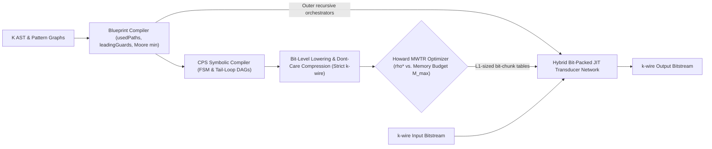
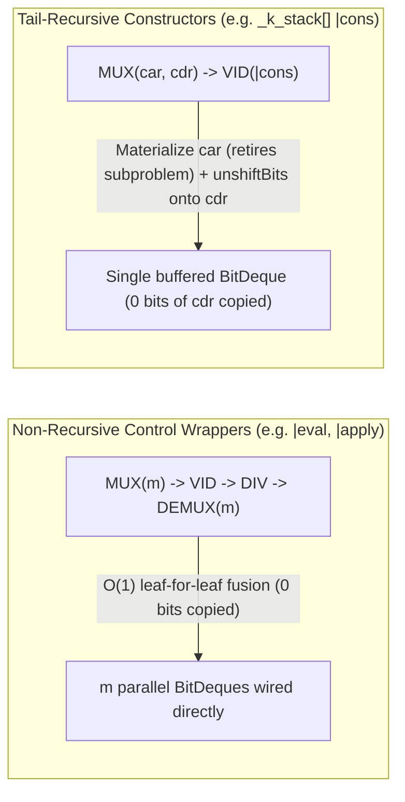
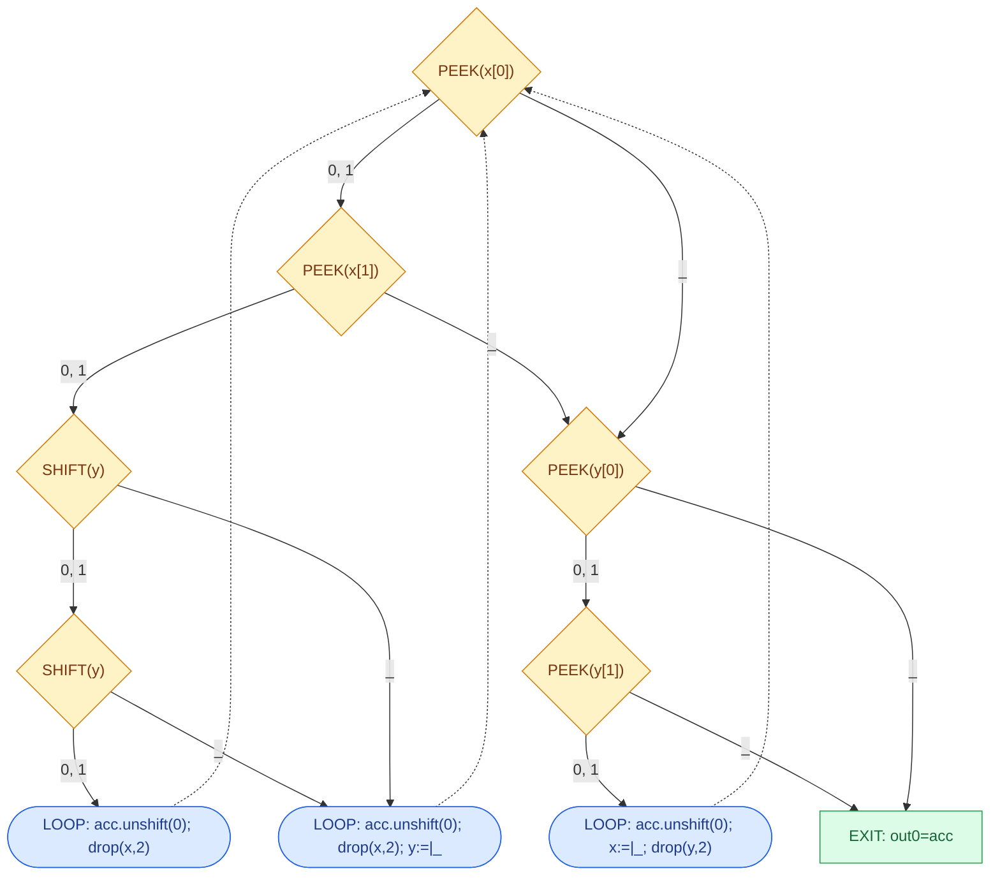
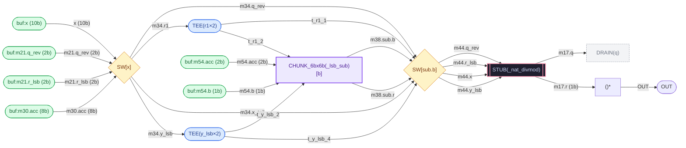

# A Hybrid JIT Pushdown and Bit-Chunk Transducer Architecture for K

**Status:** Technical Report (branch `packed-wire-compiler`)  
**Scope:** Formal specification and empirical evaluation of an incrementally constructed, bit-packed transducer runtime and static bit-chunk compiler for K operating directly over unmodified `k-wire` bitstreams.  
**References:**
- Wire format contract: [WIRE_FORMAT.md](file:///home/wojtek/gits/K/k/codecs/WIRE_FORMAT.md), [prefix-codec.mjs](file:///home/wojtek/gits/K/k/codecs/runtime/prefix-codec.mjs)
- Speed evaluation criterion: M. Yazdani, W. Fraczak, F. Welfeld, I. Lambadaris, *"A Criterion for Speed Evaluation of Content Inspection Engines"*, ICN/ICONS/MCL 2006 ([speed-eval.pdf](file:///home/wojtek/gits/K/k/DOCS/speed-eval.pdf))

---

## 1. Abstract

Compiling recursive K relations statically into monolithic finite-state transducers is infeasible in general because recursive value domains and call graphs induce unbounded state spaces. Conversely, interpreting K over heap-allocated value trees incurs structural allocation overhead and breaks streaming compatibility with K's bit-packed wire format (`k-wire`).

This report describes a hybrid execution and compilation architecture that resolves both constraints without modifying the `k-wire` serialization contract:

1. **Incremental multi-port pushdown transducer network:** Relations compile to finite blueprints over parallel bit-addressable channels (`BitDeque`). Recursive references remain unexpanded black-hole stubs until demanded by runtime data, while local graph-rewriting rules (splicing, bundle fusion, immediate retirement, barrier-waiter flushing, and tail-recursive constructor settlement) maintain bounded live topology ($O(1)$ active nodes on flat tail loops; $O(\log n)$ active nodes with $\Theta(n^{\log_2 3})$ traffic on continuation-stack Karatsuba multiplication).
2. **Static symbolic transducer compilation:** Eligible acyclic sub-relations and self-recursive tail loops are compiled statically via continuation-passing symbolic execution into single-node deterministic decision DAGs with inlined finite helpers and automatically promoted in-node registers.
3. **Variable-width `k-wire` bit-chunk lowering and MWTR symbol-size selection:** Compiled DAGs are lowered directly onto raw `k-wire` bits into flat typed-array transition tables consuming variable-width bit chunks (`1..W_raw` bits per lookup, not restricted to single-token boundaries) via sub-token prefix guards, automatic don't-care SWAR bit compression, and heterogeneous cross-schema chunking. Per-transducer chunk widths are selected under a global table-memory budget using Howard's max-plus policy-improvement algorithm for the Minimum Weight-to-Time Ratio (MWTR) criterion ([speed-eval.pdf](file:///home/wojtek/gits/K/k/DOCS/speed-eval.pdf)).

---

## 2. Wire Representation and Channel Primitives

Implementation: [bit-deque.mjs](file:///home/wojtek/gits/K/k/experiments/transducer/v4/bit-deque.mjs), [bit-codec.mjs](file:///home/wojtek/gits/K/k/experiments/transducer/v4/bit-codec.mjs), [blueprint.mjs](file:///home/wojtek/gits/K/k/experiments/transducer/v2/blueprint.mjs).

### 2.1 `k-wire` Contract and Schema Minimization

Values conform strictly to K's preorder bit serialization over closed pattern graphs $P = (V, E, v_0)$ (`patternToPropertyList`):
- Unit `{}` occupies $0$ bits.
- A `closed-product` with edges $(l_1, v_1), \dots, (l_m, v_m)$ in canonical label order is the concatenation of its field bitstreams with $0$ framing bits.
- A union node with $n$ edges in canonical order encodes tag ordinal $i \in [0, n-1]$ MSB-first in $w = \lceil \log_2 n \rceil$ bits ($0$ bits when $n \le 1$). Codepoints $i \in [n, 2^w - 1]$ are invalid (e.g., for `bits[]` with tags `0, 1, _`, codes are `00, 01, 10` and `11` is invalid).

To determine schema compatibility across arbitrary product/scalar boundaries, closed sub-pattern graphs are canonicalized by **Moore regular-tree minimization** (`canonicalSubPlistKey`), producing a unique canonical string for the minimal bisimulation quotient DFA of any recursive type.

### 2.2 `BitDeque`, Multi-Port Bundles, and 1-State Pattern DPDAs

- **`BitDeque`:** A power-of-2 `Uint32Array` bit-addressable ring buffer supporting $O(1)$ arbitrary-width (`1..30`-bit) `peekBits`, `shiftBits`, `pushBits`, `unshiftBits`, and zero-overhead deque-to-deque prefix prepending (`unshiftFromDeque`). Bit-level addressability eliminates byte-alignment padding and phase-state duplication when consuming variable-width bit chunks.
- **`BitWireBundle`:** Static `closed-product` boundaries are decomposed into hierarchical trees of independent scalar `BitDeque` leaves rather than serialized through a single channel. `DEMUX` and `MUX` nodes appear only at external boundaries or where a product is embedded inside a union variant payload.
- **`BitPatternDPDA`:** Structural traversal over arbitrary recursive bitstreams is performed by a 1-state deterministic pushdown automaton whose stack alphabet is the pattern vertex set $V$, implementing `skip` (drain and validate discarded inputs), `copy` (verbatim forwarding), and `coerce` (paired-stack tag re-encoding across distinct schemas).

---

## 3. Incremental Transducer Network Runtime

Implementation: [network-v4.mjs](file:///home/wojtek/gits/K/k/experiments/transducer/v4/network-v4.mjs), [blueprint.mjs](file:///home/wojtek/gits/K/k/experiments/transducer/v2/blueprint.mjs).

### 3.1 Blueprint Lowering and Lazy Expansion

Each K relation compiles statically to a reusable transducer blueprint over primitive operations (`identity`, `unit`, `div`, `vid`, `dot`, `comp`, `product`, `multi-switch`, `stub`) annotated with two static analyses:
- **`usedPaths`:** Identifies which input bundle leaves are read by each product branch. Unread leaves attach to a `DrainBarrier` (preserving K strict partiality on discarded values); singly read leaves wire directly with zero copying; multiply read leaves insert a scalar `TEE` performing 30-bit chunked broadcasts.
- **`leadingGuards`:** Extracts per-path sets of valid leading tags for every union branch, enabling deterministic multi-port switching (`MULTI_SW`) without buffering whenever branches are prefix-disjoint.

Every relation call site (`ref R`) is instantiated as an unexpanded black-hole **`STUB(R)`**. Execution is demand-driven (pull-scheduled from the root output deque): a `STUB(R)` expands into its sub-network (or into a single compiled node; Section 4) only when downstream demand pulls through it. Because every dynamically expanded snapshot of the network is a directed acyclic graph (recursion extends the DAG forward through fresh `STUB` expansions with no static cyclic FIFO loops), demand-driven scheduling is deadlock-free.

Unions that cannot be disambiguated deterministically execute branches sequentially inside isolated child scopes (`scopeId`) with bit-exact input replay buffers; on failure, the entire child scope is torn down and recorded bits are replayed to the next branch. Three streaming soundness invariants govern partiality and backtracking:
- **Last-branch tail splicing:** Once speculative branches $0 \dots k-2$ fail and a switch enters its final branch $k-1$, recorded bits are unshifted back onto parent deques, branch $k-1$ is wired directly onto `(inWire, outWire)`, and the switch retires immediately (preventing $O(n)$ nested switch chains).
- **Upstream failure vs. local branch mismatch:** If a speculative branch fails because an input deque itself failed upstream (`inDq.failed === true`), the switch aborts immediately rather than rolling back and invoking subsequent branches on a failed input stream.
- **Unit-input guard draining:** When a guard produces unit `{}` ($0$ bits) feeding a constant emitter or compiled exit, the downstream node still drains the upstream producer to `DONE` or `FAILED` so upstream guard failures are never silently dropped.

### 3.2 Local Graph-Rewriting and Settlement Invariants

Seven local, relation-independent rules prevent live graph growth and eliminate redundant copying while preserving exact K partiality semantics:

1. **Zero-copy `ID` and `DIV` splicing:** Any `ID` or matched `DIV` whose remaining task is schema-preserving `copy` rewires its input `BitDeque` directly to its downstream consumer and retires in $O(1)$.
2. **$O(1)$ `VID` prepend-splicing:** A variant constructor `|tag` whose input and payload schemas match prepends `tag`'s `k-wire` bits onto the front of its input `BitDeque` via `unshiftBits` and splices the deque directly downstream, avoiding tail copying.
3. **Immediate producer retirement:** Upon emitting the final bit of a closed stream, `TEE`, `DEMUX`, and finished DPDA nodes close their outputs, clear `.upstream`, and retire immediately, leaving plain buffered `BitDeque`s.
4. **Barrier-waiter flushing:** Each `DrainBarrier` tracks sibling `ID`/`VID` nodes blocked on it; when all discarded leaves finish draining, every waiter immediately executes its $O(1)$ splice or prepend-splice.
5. **Local input settlement prior to recursive expansion (`_settleStubInputs`):** Call-graph DFS statically classifies acyclic relations (`isFiniteRel`). Before expanding a recursive `STUB`, each input wire locally settles pending barriers, spliceable `ID`/`VID` chains, constant unit-tag emitters, active upstream switches, and finite helper nodes—without forcing streaming or recursive producers.
6. **Runtime schema refinement (`open-union` / `any`):** For unannotated finite helpers whose static blueprints contain `open-union` or `any` nodes, `DIV` and `VID` propagate and graft the concrete caller schema carried on incoming deques, and `DrainBarrier` defers DPDA creation until concrete schema arrival.
7. **Control fusion vs. tail-recursive constructor settlement:**

   - **`MUX -> DEMUX` bundle fusion:** When a product wrapper (`|eval`, `|apply`) splices directly into a matching destructor (`/eval`, `/apply`), matching leaf schemas fuse leaf-for-leaf in $O(1)$ with zero serialization (unwinding any single-leaf speculative lookahead bits prior to fusion).
   - **Tail-recursive constructor settlement (`_isTailRecursiveMux`):** A `MUX` whose final field shares the canonical recursive schema of its enclosing `VID` output (such as `{ car, cdr } |cons` on `_k_stack[]`) materializes only `car` before the next recursive stub expands (retiring the completed subproblem) and $O(1)$ tail-splices `cdr` via `unshiftFromDeque`. On explicit continuation-stack Karatsuba multiplication, this simultaneously guarantees $\Theta(n^{\log_2 3})$ bit transfers, $O(\log n)$ peak active nodes, and $O(n)$ buffered bits.

---

## 4. Static Symbolic Transducer Compilation

Implementation: [fsm-compiler.mjs](file:///home/wojtek/gits/K/k/experiments/transducer/v3/fsm-compiler.mjs).

A static compiler (`TransducerCompilerV3`) compiles eligible blueprints into single-node deterministic `PEEK`/`SHIFT` decision DAGs over abstract union-tag symbols, eliminating per-iteration stub instantiation on all inner loops and finite helpers while leaving outer non-tail-loop orchestrators (`_nat_divmod`, `_lsb_mul`, `_lsb_mul_small`) as JIT stubs.

- **CPS symbolic execution (`symEval`):** Symbolically evaluates `div`, `vid`, `dot`, `product`, `comp`, and `multi-switch` over symbolic port terms (`port`, `cons`, `product`, `unit`, `cont`), inlining calls to finite helper relations (`_pop_lsb_bit`, `_full_sub_bit`, `_full_add_bit`, `_push_bit_acc`, `_drop16`, `_le1_bit?`) into one fused decision DAG.
- **Committed `SHIFT` and CPS-continuation memoization:** Disjoint guarded switches without backtracking emit committed `SHIFT` nodes (keeping symbolic peek buffers empty) and hash-cons DAG nodes keyed by `(bpId, inVal, state, contId)`. This collapses unrolled finite chains such as `_drop16` and `_classify_bits` from $2^{16}$ paths into **18–21 DAG states**.
- **In-place self tail-loops (`COMPILED_LOOP`) and in-register states:** Direct tail self-calls emit `loop` leaves specifying per-port updates (`const` or `splice`). Any unit-only finite-enum port updated strictly by 1-tag constants or identity pass-through splices across all reachable loop leaves (with at least one constant update) is promoted into a local in-node register (`b` in `_lsb_sub`, `c` in `_lsb_add`, `ord` in `_cmp_msb`), eliminating all FIFO traffic on control state.
- **Provably total exit continuations:** Fixed-point reachability over compiled DAGs identifies provably total relations (no reachable `fail` leaves). Exit branches invoking total external relations (`msb_drop_zeros`, `rev_bits`, `_rev_bits`) emit `cont` handoffs directly onto the output wire and immediately retire the loop node.

On `lib/integer.k`, this pass automatically compiles **26 relations** (**18 `COMPILED_FSM`** + **8 `COMPILED_LOOP`**) in ~65–71 ms:
- **`COMPILED_FSM` (18):** `0` (1 st), `1` (1 st), `-1` (1 st), `int` (3 st), `msb_drop_zeros` (4 st), `_pop_lsb_bit` (4 st), `_full_add_bit` (10 st), `_push_bit_acc` (3 st), `_full_sub_bit` (10 st), `_lsb_push_0` (4 st), `_lsb_push_1` (4 st), `_drop1` (3 st), `_drop2` (4 st), `_drop4` (6 st), `_drop16` (18 st), `_classify_bits` (21 st), `lsb_shl1` (4 st), `_le1_bit?` (4 st, partial).
- **`COMPILED_LOOP` (8):** `trim_bits` (4 st), `_rev_bits` (4 st), `_cmp_msb` (12 st, reg `ord`), `_lsb_add` (25 st, reg `c`), `_lsb_sub` (20 st, reg `b`), `_half_max_tally` (10 st), `_lsb_split` (8 st), `lsb_shl` (8 st).

As a representative example, symbolic evaluation compiles `_half_max_tally` (which relies on 2-token speculative lookahead in the uncompiled AST) into a 10-state deterministic `PEEK`/`SHIFT` loop with zero rollbacks:

---

## 5. Variable-Width `k-wire` Bit-Chunk Lowering and MWTR Selection

Implementation: [bit-chunk-compiler.mjs](file:///home/wojtek/gits/K/k/experiments/transducer/v4/bit-chunk-compiler.mjs), [mwtr.mjs](file:///home/wojtek/gits/K/k/experiments/transducer/v4/mwtr.mjs).

### 5.1 Bit-Level Lowering and Variable-Width Chunks

Compiled decision DAGs (`COMPILED_LOOP` and multi-step `COMPILED_FSM`) are lowered directly onto raw `k-wire` bits into flat typed-array lookup tables (`Uint8Array` / `Uint32Array`) whose transitions consume a variable number of raw input bits `consumeBits ∈ 1..W_raw` in one lookup, unconstrained by single-token boundaries:

1. **Sub-token bit-prefix guards:** For peek-guarded accumulators (ports peeked at depth 0 with zero net consumption and non-empty prepend prefixes, such as `x` in `lsb_shl`), the compiler computes the shortest MSB bit-prefix uniquely matching all valid guard tags. On `bits[]`, `{"0", "1"}` (`00`, `01`) reduces to a **1-bit sub-token guard** (`peekBits(1) === 0`).
2. **Automatic don't-care bit compression (SWAR key packing):** For each stream port of tag width $w$, the compiler greedily removes bit positions $b \in \{0, \dots, w-1\}$ that (a) keep continuing tags separated from terminators and invalid codepoints across union-layout-equivalent nodes, and (b) map every tag within each masked equivalence class to identical transitions (for FSMs) or loop-equivalent transitions ignoring exit leaves (for loops) in the hash-consed DAG. At runtime, sensitive bits are gathered with 4 bitwise SWAR operations (Morton bit-packing for $w = 2, \text{mask} = \texttt{0b10}$), doubling the raw `k-wire` chunk width inside the same table footprint:
   - `lsb_shl`: `k` compresses to `1/2b`, yielding a **`16b` raw chunk** (8 tokens) in **256 entries (2.0 KB)**.
   - `_classify_bits` / `_drop16` (FSMs): `x` compresses to `1/2b`, yielding **`16b` raw chunks** in **768 / 512 entries (3.0 / 2.0 KB)**.
   - `_half_max_tally`: both `x` and `y` compress to `1/2b`, yielding a **`12b × 12b` (`24b` total) chunk** in **4,096 entries (36.0 KB)**.
   - `_lsb_split`: `k` compresses to `1/2b` while `x` retains `2/2b`, yielding an **`8b × 8b` (`16b` total) chunk** in **4,096 entries (36.0 KB)**.
3. **Heterogeneous cross-schema FSM chunking:** Multi-step 1-stream FSMs whose `SHIFT` paths traverse unions of differing bit-widths compile into `W_raw = 8` tables tracking target schema nodes across states, consuming variable widths (`1..8` bits) spanning multiple distinct union schemas in a single lookup.
4. **Closed-tail safety:** On closed input tails shorter than `W_raw`, unions with an invalid all-ones codepoint (`bits[]`: `11`) use `peekBitsPaddedOnes(W_raw)` so transitions terminate strictly before padding; heterogeneous tables without invalid sentinels use 0-padding guarded by `consumeBits <= dq.lenBits`, ensuring zero padding bits are consulted.

### 5.2 MWTR Worst-Case Throughput Criterion and Memory-Budgeted Optimization

Following [speed-eval.pdf](file:///home/wojtek/gits/K/k/DOCS/speed-eval.pdf) (Sections 2–3), each transducer at candidate chunk configuration $k$ is represented as a weighted directed graph $G = (V, E, w, t)$, where $w(e)$ is the number of raw `k-wire` input bits consumed along edge $e$ and $t(e)$ is the number of table reads ($t(e) = 1$ per chunk lookup; $t(e) = 1$ per input stream `PEEK`/`SHIFT` in base mode, with in-register checks weighted $0$). Worst-case throughput (in `k-wire` bits per memory read) is

$$\rho^*(G) = \inf_{p \in P} \frac{w(p)}{t(p)} = \min_{C \in G} \frac{\sum_{e \in C} w(e)}{\sum_{e \in C} t(e)},$$

solved exactly by **Howard's policy-improvement algorithm in max-plus algebra** ([mwtr.mjs](file:///home/wojtek/gits/K/k/experiments/transducer/v4/mwtr.mjs)), returning both $\rho^*(G)$ and the critical bottleneck cycle $C^*$.

Given a global table-memory budget $M_{\max}$ across a library $\{T_1, \dots, T_m\}$, `BitChunkCompilerV4.optimizeForMemoryBudget` enumerates strictly Pareto-improving chunk widths per transducer and iteratively upgrades the transducer currently attaining the minimum $\rho^*(T_i)$ (breaking ties by highest $\Delta \rho^* / \Delta M$) while remaining within $M_{\max}$.

---

## 6. Empirical Evaluation

All measurements below were produced by [test-v4.mjs](file:///home/wojtek/gits/K/k/experiments/transducer/v4/test-v4.mjs) on Node.js v22 against `lib/integer.k` and a heterogeneous schema benchmark.

### 6.1 Correctness, Wire Compatibility, and MWTR Validation

- **Semantic conformance:** 100% agreement with `k.compile` across `trim_bits`, `rev_bits`, `lsb_try_sub`, `lsb_add`, `half_max_tally`, `lsb_split`, `lsb_shl`, `cmp`, `plus`, `minus`, `divmod`, `mod` (including division-by-zero failure propagation), `times` (zero, sign, and Karatsuba threshold boundaries), and `gcd`.
- **Bit-exact `k-wire` compliance:** Output bitstreams for `bits[]`, `mod`, `divmod`, and `times` matched K's `codecs/runtime/prefix-codec.mjs` (`encodeToWire` payload suffix) bit-for-bit with zero trailing padding and decoded directly via `decodeLazyNode`.
- **MWTR solver verification:** On the 6-node Sun Fire B10n graph of [speed-eval.pdf](file:///home/wojtek/gits/K/k/DOCS/speed-eval.pdf) (Figure 2), Howard's algorithm converged in 3 iterations to exact $\rho^* = 8/6 = 1.3333$ bits/memory-cycle on critical cycle `[v3 -> v3]`. On `lib/integer.k`'s unchunked `_lsb_add`, the solver automatically identified an asymmetric carry-propagation cycle (`x = |_`, `y = 1111...`, `c = 1`) pinning base worst-case throughput at `1.00` b/rd (versus `2.00` b/rd on symmetric operands).

### 6.2 Synthesized Bit-Chunk Catalog (`lib/integer.k`, Built in 62.0 ms)

| Transducer | Kind | Raw `k-wire` Window $W_{\text{raw}}$ | Sensitive Bits / Token | Table Entries (Bytes) | Base $\rho^*$ (b/rd) | Chunk $\rho^*$ (b/rd) | Read Reduction | Mechanism |
| --- | :---: | :---: | :---: | ---: | ---: | ---: | ---: | --- |
| `trim_bits` | LOOP | 12b | 2/2b | 4,096 (32.0 KB) | 2.00 | **12.00** | 6.0× | 6-token chunk |
| `_rev_bits` | LOOP | 12b | 2/2b | 4,096 (32.0 KB) | 2.00 | **12.00** | 6.0× | 6-token chunk |
| `_cmp_msb` | LOOP | 6b × 6b | 2/2b, 2/2b | 12,288 (108.0 KB) | 2.00 | **12.00** | 6.0× | In-node reg `ord` |
| `_lsb_add` | LOOP | 6b × 6b | 2/2b, 2/2b | 8,192 (72.0 KB) | 1.00 | **12.00** | 12.0× | In-node reg `c` |
| `_lsb_sub` | LOOP | 6b × 6b | 2/2b, 2/2b | 8,192 (72.0 KB) | 2.00 | **12.00** | 6.0× | In-node reg `b` |
| `_drop2` | FSM | 4b (1 st) | 1/2b | 4 (0.0 KB) | 2.00 | **4.00** | 2.0× | SWAR don't-care FSM |
| `_drop4` | FSM | 8b (1 st) | 1/2b | 16 (0.1 KB) | 2.00 | **8.00** | 4.0× | SWAR don't-care FSM |
| `_drop16` | FSM | 16b (2 st) | 1/2b | 512 (2.0 KB) | 2.00 | **16.00** | 8.0× | SWAR don't-care FSM |
| `_classify_bits` | FSM | 16b (3 st) | 1/2b | 768 (3.0 KB) | 2.00 | **12.00** | 6.0× | SWAR don't-care FSM |
| `_half_max_tally` | LOOP | 12b × 12b | 1/2b, 1/2b | 4,096 (36.0 KB) | 1.00 | **24.00** | 24.0× | SWAR don't-care pack |
| `_lsb_split` | LOOP | 8b × 8b | 1/2b, 2/2b | 4,096 (36.0 KB) | 2.00 | **16.00** | 8.0× | Loop-equiv don't-care |
| `lsb_shl` | LOOP | 16b | 1/2b | 256 (2.0 KB) | 1.00 | **16.00** | 16.0× | **1b sub-token guard**, SWAR pack |

### 6.3 Heterogeneous Cross-Schema Chunking (`classify_pkt`)

A 4-level nested K schema combining union widths `1b -> 3b -> 2b -> 2b` compiles to a single 512-entry (3.0 KB) `W_raw = 8` table whose transitions consume variable widths across all valid paths in exactly 1 lookup:

| Input Packet Path | Wire Bits | Chunk Reads | Bits Consumed | Distinct Schemas Retired | Output |
| --- | ---: | ---: | ---: | ---: | :---: |
| `slow` | 1b | 1 | 1b | 1 (`hdr`) | `\|miss_slow` |
| `fast/op3` | 4b | 1 | 4b | 2 (`hdr`, `op`) | `\|miss_op` |
| `fast/op0/m2` | 6b | 1 | 6b | 3 (`hdr`, `op`, `mode`) | `\|miss_mode` |
| `fast/op0/m0/a` | 8b | 1 | 8b | 4 (`hdr`, `op`, `mode`, `flag`) | `\|hit` |

### 6.4 MWTR Memory-Budget Pareto Frontier (`lib/integer.k`)

| Budget $M_{\max}$ | Used Table Memory | Worst Loop $\rho^*$ (b/rd) | Avg $\rho^*$ (b/rd) | `mod(512b)` Loop Reads (Time) | `times(256b)` Loop+FSM Reads (Time) |
| ---: | ---: | ---: | ---: | :---: | :---: |
| 0 KB (no chunks) | 0.0 KB | 1.0 | 1.8 | 142,478 (156.2 ms) | 63,933 (138.6 ms) |
| 4 KB | 3.9 KB | 4.0 | 6.7 | 112,086 (80.0 ms) | 38,275 (106.0 ms) |
| 16 KB | 15.7 KB | 4.0 | 8.0 | 60,172 (62.5 ms) | 24,288 (92.1 ms) |
| **64 KB (L1 sweet spot)** | **43.3 KB** | **8.0** | **10.7** | **57,877 (62.0 ms)** | **21,660 (92.5 ms)** |
| 192 KB | 178.3 KB | 8.0 | 11.3 | 41,838 (65.3 ms) | 18,043 (116.7 ms) |
| 384 KB | 359.1 KB | 12.0 | 12.3 | 40,331 (61.7 ms) | 16,683 (94.3 ms) |

At `43.3 KB` (resident within L1 data cache), worst-case streaming throughput rises from `1.0` to `8.0` b/rd (average `10.7` b/rd) and achieves minimal wall-clock time (`62.0 ms` on 512-bit `mod`; `92.5 ms` on 256-bit Karatsuba `times`). Expanding to `359.1 KB` raises $\rho^*$ to `12.0` b/rd and cuts logical reads another ~25%, but yields no wall-clock gain as tables spill beyond L1 cache—confirming empirically the necessity of memory-bounded symbol-size selection.

### 6.5 Scaling Benchmarks

**`rev_bits` (12-bit chunks, 6 tokens/read):**

| Bits ($n$) | Chunk Reads | `k-wire` Bits / Read | Tokens / Read | Peak Active Nodes |
| ---: | ---: | ---: | ---: | ---: |
| 16 | 3 | 10.7 | 5.33 | 3 |
| 64 | 11 | 11.6 | 5.82 | 3 |
| 256 | 43 | 11.9 | 5.95 | 3 |

**`mod` (4-bit to 1024-bit):**

| Scale Case | Runtime | `k-wire` Bits / Chunk Read | Tokens / Read | Peak FIFO Bytes | Peak Active Nodes |
| --- | ---: | ---: | ---: | ---: | ---: |
| 16-bit: `mod(50000, 97)` | 1.6 ms | 9.3 b | 2.98 | 14 B | 14 |
| 64-bit: `mod(10^19, 10^9+7)` | 8.9 ms | 11.5 b | 3.41 | 44 B | 14 |
| 256-bit: `mod(10^76, 10^38+7)` | 23.8 ms | 11.8 b | 3.45 | 163 B | 14 |
| 512-bit: `mod(10^153, 10^76+19)` | 52.9 ms | 11.9 b | 3.54 | 323 B | 14 |
| 1024-bit: `mod(10^307, 10^153+29)` | 132.7 ms | 12.0 b | 3.54 | 643 B | 14 |

**Karatsuba `times` (16-bit to 2048-bit $\times$ 2048-bit = 4,096-bit product):**

| Scale Case | Depth $d$ | Runtime | `k-wire` Bits Transferred | Doubling Ratio (Ideal $3.00\times$) | Loop / FSM Chunk Reads | `k-wire` b/rd | 1b Sub-Token Guards | Peak FIFO Bytes | Peak Active Nodes |
| --- | ---: | ---: | ---: | ---: | :---: | ---: | ---: | ---: | ---: |
| 16-bit (schoolbook) | 0 | 1.6 ms | 3,599 | — | 181 / 4 | 11.4 | 0 | 91 B | 52 |
| 64-bit (L2) | 2 | 19.4 ms | 38,720 | 3.88× | 1,506 / 64 | 11.5 | 12 | 146 B | 90 |
| 256-bit (L4) | 4 | 122.1 ms | 401,709 | 3.36× | 15,376 / 552 | 11.8 | 108 | 623 B | 154 |
| 512-bit (L5) | 5 | 384.9 ms | 1,292,489 | 3.22× | 48,925 / 1,810 | 11.8 | 362 | 1,311 B | 200 |
| 1024-bit (L6) | 6 | 1,101.3 ms | 3,869,150 | 2.99× | 145,463 / 5,232 | 11.8 | 1,043 | 2,641 B | 248 |
| 2048-bit (L7) | 7 | 3,323.0 ms | 11,814,428 | 3.05× | 443,371 / 15,638 | 11.8 | 3,110 | 5,312 B | 300 |

Key asymptotic properties of the resulting system:
- **Division (`mod`):** Strictly constant `14` peak active nodes and linear $O(n)$ live FIFO memory (`643 B` at 1024 bits), sustaining `12.0` `k-wire` bits/read in inner loops.
- **Karatsuba multiplication (`times`):** Exact $\Theta(n^{\log_2 3})$ wire bit scaling (`2.99×–3.05×` per doubling at 1024b–2048b), logarithmic $O(\log n)$ peak active nodes (`300` at 2048 bits), and linear $O(n)$ peak live FIFO memory (`5.2 KB` for a 4,096-bit product).
- **Remaining runtime profile:** While inner compiled loops sustain `11.8–12.0` `k-wire` bits/read across both benchmarks, profiling large Karatsuba runs shows that ~85% of JavaScript wall-clock time is spent allocating and garbage-collecting outer JIT graph nodes inside the $3^d$ non-tail leaf invocations of `_lsb_mul_small` and `_lsb_mul`.

### 6.6 Representative Runtime Network Snapshots

The snapshots below are captured directly from the executing bit-packed network. Edge annotations `(Nb)` indicate live packed `k-wire` bits buffered in `BitDeque` channels; rounded green pills (`buf:...`) denote retired producers reduced to plain bit buffers; dark double-bordered boxes are unexpanded `STUB`s; purple nodes are compiled bit-chunk transducers.

**`mod(13, 5)` at `_lsb_sub` expansion (8 active nodes, 26 live FIFO bits):**

**Karatsuba `times(1000003, 999983)` during split phase (21 active nodes, 94 live FIFO bits):**

```mermaid
flowchart LR
  ROOT_OUT(["OUT"])
  N10["|+"]
  N19["CHUNK_12b(trim_bits)"]:::stride
  N23["CHUNK_12b(_rev_bits)"]:::stride
  N26["|nil"]
  N27["{}"]
  N61(["TEE(sx.lo×2)"]):::mux
  N62(["TEE(sy.lo×2)"]):::mux
  N63(["MUX(2)"]):::mux
  N64(["MUX(5)"]):::mux
  N65(["TEE(k×3)"]):::mux
  N67[["STUB(lsb_split)"]]:::stub
  N68(["TEE(x×2)"]):::mux
  N69(["TEE(y×2)"]):::mux
  N84{"SW[*]"}:::switch
  N85{"SW[cx,cy]"}:::switch
  N86(["TEE(x×2)"]):::mux
  N87(["TEE(y×2)"]):::mux
  N89[["STUB(_classify_bits)"]]:::stub
  N90["FSM_CHUNK_16b(_classify_bits)"]:::stride
  N94["CHUNK_8bx8b(_lsb_split)"]:::stride
  N98["CHUNK_12bx12b(_half_max_tally)"]:::stride
  N10 -->|"OUT (1b)"| ROOT_OUT
  N84 -->|"m15"| N23
  N19 -->|"m16"| N10
  N23 -->|"m17"| N19
  BUF_18(["buf:m18.acc (2b)"]):::buf -->|"m18.acc (2b)"| N23
  N26 -->|"m21.stack"| N63
  N27 -->|"m26"| N26
  BUF_38(["buf:t_x_3 (42b)"]):::buf -->|"t_x_3 (42b)"| N68
  BUF_40(["buf:t_y_4 (42b)"]):::buf -->|"t_y_4 (42b)"| N69
  N98 -->|"m54.k"| N65
  N94 -->|"m58.sx.hi"| N64
  N94 -->|"m58.sx.lo"| N61
  N67 -->|"m58.sy.hi"| N64
  N67 -->|"m58.sy.lo"| N62
  N61 -->|"t_sx.lo_0"| N64
  N61 -->|"t_sx.lo_1"| N86
  N62 -->|"t_sy.lo_0"| N64
  N62 -->|"t_sy.lo_2"| N87
  N63 -->|"mux_cons (1b)"| N85
  N64 -->|"mux_need_z2 (2b)"| N63
  N65 -->|"t_k_0"| N64
  N65 -->|"t_k_2"| N94
  N65 -->|"t_k_3"| N67
  N68 -->|"t_x_0"| N98
  N68 -->|"t_x_2"| N94
  N69 -->|"t_y_0"| N98
  N69 -->|"t_y_3"| N67
  N85 -->|"m94"| N84
  N90 -->|"m99.cx"| N85
  N89 -->|"m99.cy"| N85
  N86 -->|"t_x_0"| N90
  N86 -->|"t_x_3"| N85
  N87 -->|"t_y_1"| N89
  N87 -->|"t_y_4"| N85
  BUF_109(["buf:m108.lo_rev (2b)"]):::buf -->|"m108.lo_rev (2b)"| N94
  BUF_112(["buf:m112.acc (2b)"]):::buf -->|"m112.acc (2b)"| N98
  classDef stub fill:#1e1e2e,color:#cdd6f4,stroke:#f38ba8,stroke-width:2px
  classDef stride fill:#ede9fe,color:#4c1d95,stroke:#7c3aed,stroke-width:2px
  classDef switch fill:#fef3c7,color:#78350f,stroke:#d97706
  classDef mux fill:#dbeafe,color:#1e3a8a,stroke:#2563eb
  classDef buf fill:#dcfce7,color:#166534,stroke:#16a34a
```

---

## 7. Role of Tail Recursion in a Transducer Network

Whereas call-stack evaluators require uniform tail recursion to avoid $O(n)$ stack frame growth, a pull-driven transducer network changes the trade-off substantially across three distinct recursion patterns:

| Recursion Pattern | Representative Relations | Effect of Tail Recursion | Architectural Cause |
| :--- | :--- | :---: | :--- |
| **Stateful flat iteration & reversing loops** | `_nat_divmod`, `_rev_bits`, `_lsb_sub`, `_cmp_msb` | **Beneficial** | Prevents $O(n)$ downstream post-processing chains; maintains $O(1)$ active nodes and enables direct in-place `COMPILED_LOOP` / bit-chunk synthesis. |
| **Output-guarded (tail-modulo-constructor) recursion** | `lsb_add`, `lsb_split` (`lo`), `lsb_shl`, `half_max_tally`, list `map`/`filter` | **Counterproductive** | Accumulator tail recursion forces $O(n)$ buffering plus a `_rev_bits` reversal pass; non-tail prefix emission streams online in $O(1)$ nodes and $O(1)$ FIFO memory. |
| **Tree recursion via explicit continuation stacks** | Karatsuba `_lsb_mul` (`_k_stack[]`) | **Mostly redundant** *(ordering caveat)* | Unexpanded `STUB`s and suspended wires already represent continuations natively; serializing `_k_stack[]` adds `MUX`/`DEMUX` frame traffic. |

1. **Stateful flat iteration and reversing loops:** When post-call computation cannot emit output before the recursive call terminates (e.g., `_rev_bits`, `_lsb_sub` whose borrow validation and zero-trimming depend on the MSB, or `_nat_divmod` threading remainder state), non-tail recursion chains $O(n)$ live downstream nodes (`[STUB(R)] -> [post_n] -> ... -> [post_1]`). Tail recursion collapses live topology to $O(1)$ nodes (`14` on 1024-bit `mod`) and directly matches the current static loop compiler.
2. **Output-guarded (tail-modulo-constructor) streaming recursion:** Writing naturally streaming relations (`lsb_add`, `half_max_tally`, `lsb_split`) in accumulator tail-recursive form forces $O(n)$ buffering in `acc` followed by a full `_rev_bits` reversal pass, roughly doubling wire bit traffic and eliminating online latency. In contrast, under a non-tail output-guarded definition (`R = ... R |out_bit`), the downstream `VID(|out_bit)` emits to `outDq` *before* pulling `STUB(R)`, then splices `STUB(R)` directly onto `outDq` and retires—achieving $O(1)$ live nodes, $O(1)$ FIFO memory, and zero reversal passes.
3. **Tree recursion via explicit continuation stacks:** Manually encoding a CEK continuation stack (`_k_stack[]`, `|eval`, `|apply`, `|cons`) inside `k-wire` double-encodes continuations in a runtime whose unexpanded `STUB`s already suspend unreached work. Even with `MUX -> DEMUX` bundle fusion and tail-recursive constructor settlement, each frame still incurs `MUX`/`DEMUX` serialization of `car`. Direct non-tail tree recursion eliminates frame serialization entirely, with one scheduling caveat: whereas `_k_stack[]` explicitly enforces strict depth-first evaluation, a binary downstream consumer (such as `lsb_sub(z1, z0)`) pulling two sibling recursive `STUB`s in bit-by-bit lockstep keeps two branches open per depth level ($O(n)$ live nodes instead of $O(\log n)$) unless the scheduler settles sibling `STUB`s sequentially.

---

## 8. Further Work

1. **Tail-Modulo-Constructor (Guarded Streaming) Loop Compilation and Sequential Sibling Scheduling:**
   Extending `TransducerCompilerV3` and `BitChunkCompilerV4` to recognize tail-modulo-output-prefix self-calls—emitting variable-width chunks forward via `outDq.pushBits(emitCode, emitBits)` rather than reversing into `accDq.unshiftBits(...)`—will allow K libraries to express online relations (`lsb_add`, `lsb_split`, `half_max_tally`, list/stream transforms) in direct streaming style with $O(1)$ FIFO memory and no `_rev_bits` passes. Pairing this with sequential sibling `STUB` settlement in the scheduler will allow direct non-tail tree recursion (such as Karatsuba without `_k_stack[]`) to retain $O(\log n)$ peak active nodes without continuation-frame serialization.
2. **Flat Bytecode / WebAssembly / Native Lowering of Outer Orchestrators:**
   Because inner compiled loops now operate as pure typed-array kernels over linear `BitDeque` buffers, the dominant remaining overhead on tree-recursive workloads is JS object allocation in outer non-tail orchestrators (`_lsb_mul_small`, `_lsb_mul`, `_nat_divmod`). Lowering outer blueprints and small-domain loops into a flat bytecode or WebAssembly/native runtime over linear-memory `BitDeque`s and L1-resident chunk tables would remove heap allocation from the critical path.
3. **Cache-Aware and Inter-Transducer Global MWTR Optimization:**
   The current MWTR allocator models each lookup at unit cost $t(e) = 1$ under a hard byte limit $M_{\max}$. Two natural extensions are:
   - Incorporating a cache-hierarchy latency model $t(e, M_{\text{total}})$ capturing the L1/L2 spill cliff observed empirically between `43 KB` and `359 KB`, so symbol sizes self-tune to the host cache.
   - Extending MWTR analysis across composed inter-transducer graphs (incorporating static or profiled call frequencies) and supporting two-level / wildcard-compressed transition tables for wide union alphabets where single flat tables scale exponentially.
4. **Cross-Transducer Pipeline Fusion (Deforestation):**
   Composed compiled transducers such as `_lsb_sub -> _rev_bits -> msb_drop_zeros -> rev_bits` currently communicate via intermediate `BitDeque`s. Statically composing same-direction streaming producer–consumer DAGs (e.g., `int -> trim_bits` or `trim_bits -> _rev_bits`) would eliminate intermediate buffering and further reduce wire traffic.
5. **General Polymorphism and Open-Pattern Compilation:**
   Extending beyond closed monomorphic schemas and runtime schema refinement requires either call-site monomorphization or boundary remapping that exposes only inspected fields/tags while treating uninspected subtrees as opaque copy/skip bit spans backed by `fastSkipSubtree`.
6. **Non-Arithmetic Workloads (Unicode, Trees, Self-Hosted ASTs):**
   Evaluating the architecture on K's Unicode string schemas (`ascii` 3b + 7×1b bit fields, BMP/supplementary planes), recursive algebraic trees, and self-hosted compiler passes over `CORE_PATTERN_PROPERTY_LIST` will exercise heterogeneous variable-width chunking and multi-symbol lookahead on irregular bitstreams.
7. **Formal Soundness Verification:**
   Mechanizing a small-step bisimulation proof between the local bit-packed graph-rewriting semantics (barrier-waiter flushing, `MUX -> DEMUX` fusion with lookahead unwind, tail-recursive constructor settlement, closed-tail padding, and loop-equivalent don't-care bit masks) and K's reference relational semantics would establish formal correctness guarantees prior to production integration.
