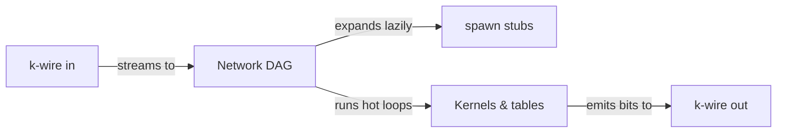
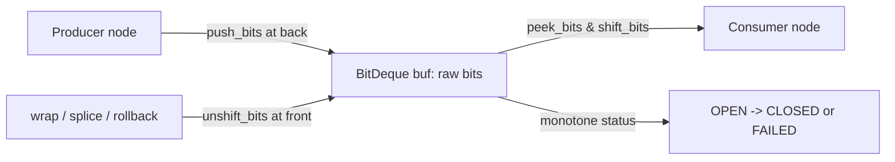
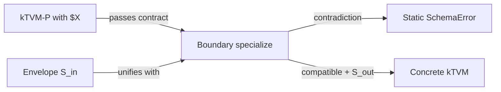
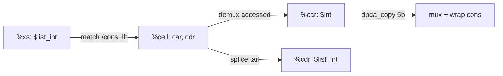
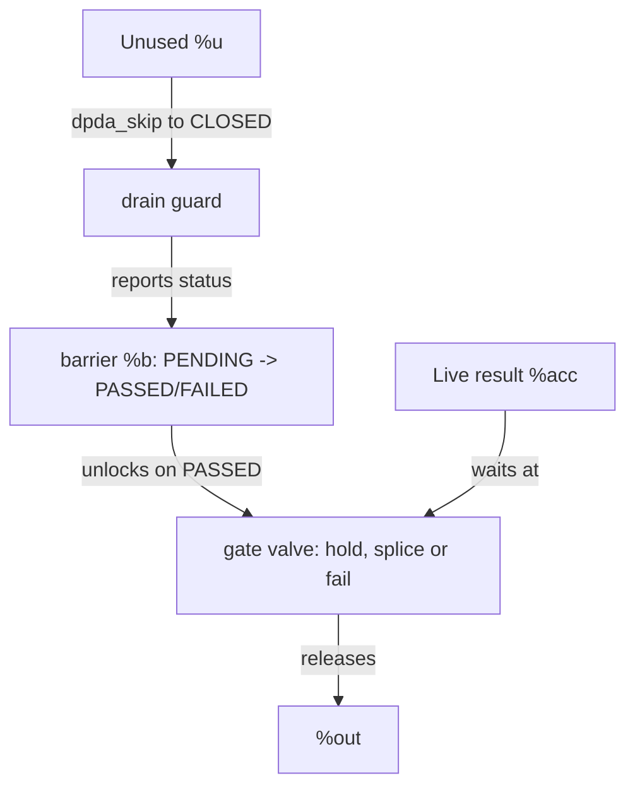
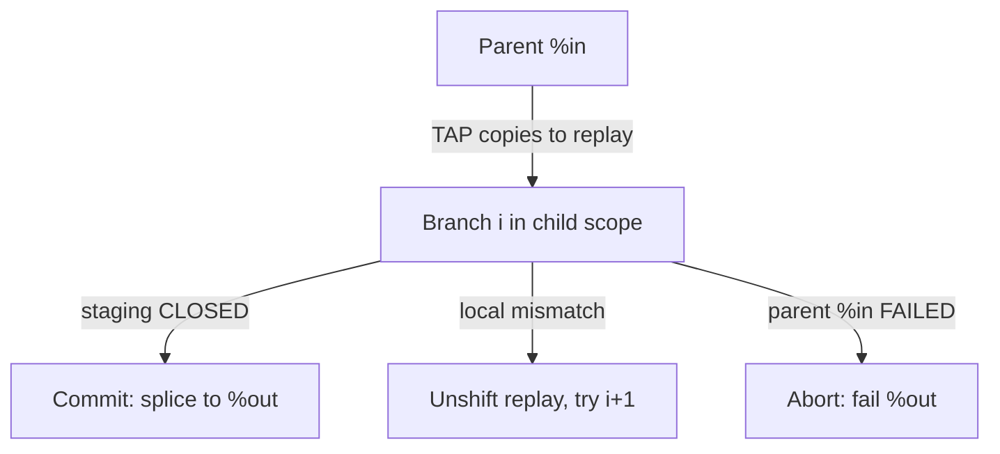
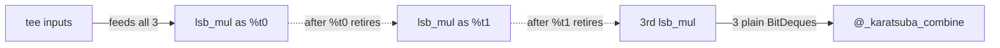
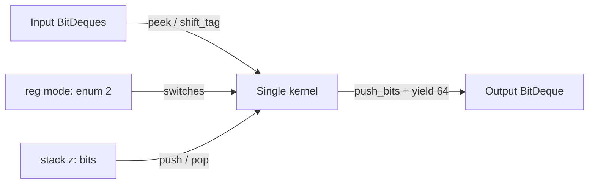
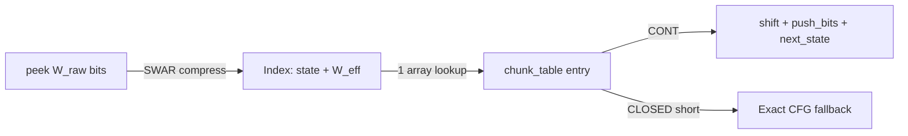

# Slide 1: `kTVM`: A Streaming Pushdown Transducer Virtual Machine for K
- Executes K relations directly over unmodified, bit-packed `k-wire` bitstreams—without heap-boxed value trees or monolithic `FSM` explosion
- Formalizes a two-tier `DAG` + kernel architecture unifying dual-schema `BitDeque` channels, boundary polymorphism specialization (`kTVM-P` → `kTVM`), strict partiality, and `MWTR` bit-chunk tables (`k/DOCS/KTVM_SPEC.md`, v0.1)

Notes: Welcome to this walkthrough of `kTVM`—the K Transducer Virtual Machine, specified in `k/DOCS/KTVM_SPEC.md` version 0.1. In one sentence: `kTVM` executes K relations directly over unmodified, bit-packed `k-wire` bitstreams without unpacking heap value trees or blowing up a static finite-state machine, by combining dual-schema `BitDeque` channels, boundary polymorphism specialization, strict partiality, and `MWTR` bit-chunk kernels. Let us walk through each piece step by step.

# Slide 2: Who this is for
- You know algebraic types (products and unions), finite-state machines (`FSM`), directed acyclic graphs (`DAG`), and compiler intermediate representations (`IR`)
- Each `kTVM` building block—`k-wire`, `BitDeque`, dual schemas, `kTVM-P` specialization, and `MWTR` tables—is defined visually on screen as we go
- Full glossary and source citations live on the backup slides at the end

Notes: You do not need to have read the K compiler or the earlier V1 through V4 prototypes. If you are comfortable with tagged unions, structs, finite-state machines, directed acyclic graphs, and compiler intermediate representations, you have everything you need. Every `kTVM` mechanism gets its own slide and diagram before we rely on it, grounded in one concrete running example.

# Slide 3: Headline results: `kTVM` runs K directly on packed `k-wire` bits
- Dual-schema `BitDeque` channels and one `splice` rule replace heap-boxed value trees and avoid `FSM` blowup
- Boundary specialization (`kTVM-P` → `kTVM`) resolves polymorphism when an enveloped input arrives
- Compiled kernels sustain `12.15` `k-wire` bits/read (`98.4%` chunked) and cut 2,048-bit Karatsuba wire traffic by `45%` [measured]

Notes: Before diving into the details, here is the bottom line from the V4 prototype that `kTVM` formalizes. Replacing heap value trees with dual-schema `BitDeque` channels and a single `splice` rule, settling polymorphism at the envelope boundary, and fusing inner loops into bit-chunk lookup tables sustains 12.15 `k-wire` bits per read with 98.4 percent of loop steps inside chunk tables—cutting 2,048-bit Karatsuba wire traffic by 45 percent. By the end of this deck, you will see exactly how every layer achieves that.

# Section: k-wire and the BitDeque channel

# Slide 4: `k-wire` packs a `pattern[]` envelope followed by raw payload bits
- Every `k-wire` message is two bit-contiguous parts: a decoded `pattern[]` schema graph, then the payload tree encoded under it
- Products concatenate fields in canonical label order with `0` framing bits; unit `{}` takes `0` bits
- Unions with `n` tags encode tag ordinal `0..n-1` most-significant bit first in `ceil(log2 n)` bits (`0` bits if `n <= 1`); no pointers or byte gaps inside


Notes: First, what is `k-wire`? A `k-wire` message has no JSON container, no pointers, and no length prefixes. [[cue:H]] It starts with a pattern header encoded under K's shared `pattern[]` schema, describing the exact graph of products and unions in the value. [[cue:P]] Immediately after the header—with no byte-alignment gap—comes the payload: products simply concatenate their fields in canonical label order, empty unit `{}` takes zero bits, and an `n`-tag union writes its tag ordinal most-significant-bit first in ceiling log-base-2 of `n` bits. [[cue:W]] Only the very last byte of the whole stream is zero-padded.

# Slide 5: Running example: `@reverse` transforms 13 raw `k-wire` bits directly
- Running example (`lib/generic.k`): `@reverse[$X]` reverses `{ {}|_|1|+ car,` `{ {}|_|1|- car,` `{}|nil cdr }` `|cons cdr } |cons`
- Bit-level goal: transform `0 00110 0 10110 1` → `0 10110 0 00110 1` directly (`cons=0, nil=1;` `+=0, -=1;` `0=00, 1=01, _=10`)

| Slice | Canonical tags | Bits | Size |
| --- | --- | --- | --- |
| 1st `cons` | `cons` | `0` | 1 bit [modeled] |
| 1st `car` | `+`, `1`, `_` | `0 01 10` | 5 bits [modeled] |
| 2nd `cons` | `cons` | `0` | 1 bit [modeled] |
| 2nd `car` | `-`, `1`, `_` | `1 01 10` | 5 bits [modeled] |
| End `nil` | `nil`, `{}` | `1` | 1 bit [modeled] |

Notes: Here is the running example we will follow through the whole deck: executing K's polymorphic `reverse` relation from `lib/generic.k` on a concrete two-element `list[int[]]` nesting two `cons` records over `nil`, with `{}|_|1|+` as the first `car` and `{}|_|1|-` as the second `car`. With zero framing bits inside products, that whole nested value flattens into thirteen raw bits on the wire: `0 00110 0 10110 1`. [[cue:row:1]] First, the outer `cons` tag takes one bit, zero. [[cue:row:2]] The first `car` takes five bits: zero for plus, zero-one for tag one, and one-zero for underscore. [[cue:row:3]] The inner `cons` tag takes one bit. [[cue:row:4]] The second `car` takes five bits starting with one for minus. [[cue:row:5]] Finally, `nil` takes one bit, one. `kTVM`'s job is to transform those thirteen bits into `0 10110 0 00110 1`—swapping the two five-bit payloads—directly on packed bits without unpacking a heap tree.

# Slide 6: `kTVM` pairs a dynamic `DAG` network with finite compiled kernels
- Network tier: a dynamic `DAG` of `BitDeque` channels handles arbitrary recursion lazily via `spawn` stubs
- Kernel tier: finite helpers and hot loops compile into single-node kernels and multi-bit lookup tables
- Result: streams directly over packed `k-wire` bits—no heap-boxed value trees and no monolithic `FSM` blowup



Notes: How does `kTVM` execute recursive K programs directly on packed bits? It splits execution cleanly into two tiers. [[cue:W]] Raw `k-wire` bits stream directly into [[cue:N]] a dynamic directed acyclic network connected by `BitDeque` channels. [[cue:S]] Recursive calls stay unexpanded as lazy `spawn` stubs until downstream demand pulls on them, so unbounded recursion never blows up a static finite-state machine. [[cue:K]] Meanwhile, finite helpers and hot inner loops compile into single-node kernels backed by multi-bit lookup tables, [[cue:O]] streaming packed `k-wire` bits straight to the output without heap-boxed value trees.

# Slide 7: A `BitDeque` is an `SPSC` bit-addressable double-ended queue
- Bit-addressable `k-wire` channel (`1..32` bits/op): `push_bits` appends at back; `peek_bits` / `shift_bits` inspect/pop at front—no byte padding
- Double-ended: `unshift_bits` / `unshift_deque` prepend at front in `O(1)` amortized for tag wrapping, tail splicing, and rollback
- `kTVM` `SPSC` (single-producer, single-consumer) ownership; monotone status `OPEN -> CLOSED | FAILED`; abstract `ADT` (backing storage swappable)



Notes: Now let us define `BitDeque`, the uniform channel primitive in `kTVM`. Unlike a standard byte FIFO, a `BitDeque` is bit-addressable and double-ended. [[cue:P]] A single producer appends one to thirty-two bits at the back with `push_bits`. [[cue:B]] The buffer holds raw unread `k-wire` bits with zero alignment gaps. [[cue:C]] A single consumer inspects bits with `peek_bits` and advances with `shift_bits` from the front. [[cue:PR]] Crucially, prefix constructors like `wrap`, tail splices, and speculative rollbacks can also prepend bits at the front in amortized constant time using `unshift_bits` and `unshift_deque`. [[cue:ST]] Each channel moves monotonically from `OPEN` to either `CLOSED` or `FAILED`, hidden behind an abstract data type (`ADT`) so backends can swap ring buffers or slab arenas without changing VM semantics.

# Slide 8: Dual schemas separate upstream obligation (`prodSchema`) from downstream view (`consSchema`)
- Continuing `@reverse` on `%newacc` (`$cell = { car: $int, cdr: $list_int }`): `prodSchema` tracks the suffix expected from upstream, `consSchema` tracks the full consumer view, and `aligned` marks a fresh value boundary
- Invariant: `(already read) · buf · (any valid prodSchema suffix)` is always a valid `k-wire` value of `consSchema`

| Step on `%newacc` | `buf` | `prodSchema` | `consSchema` | `aligned` |
| --- | --- | --- | --- | --- |
| 1. Fresh `%newacc` | empty | `$list_int` | `$list_int` | `true` |
| 2. `wrap cons` pushes `0` | `0` | `$cell` | `$list_int` | `true` |
| 3. `mux` writes `car` | `0 00110` | `$list_int` | `$list_int` | `true` |
| 4. `shift_tag` peels `0` | `00110` | `$list_int` | `$cell` | `true` |

Notes: Because constructors like `wrap` emit prefix bits ahead of an upstream producer in constant time, each `BitDeque` tracks two schemas—upstream `prodSchema` and downstream `consSchema`—plus an `aligned` boundary flag. Continuing `@reverse`, trace channel `%newacc` across four consecutive steps under one suffix invariant: already-read bits, plus `buf`, plus any valid `prodSchema` suffix, always form a valid `consSchema` value. [[cue:row:1]] Step one: fresh `%newacc` starts empty with both schemas equal to `$list_int` and `aligned` true. [[cue:row:2]] Step two: `wrap` pushes the one-bit `cons` tag `0`; `prodSchema` narrows to `$cell` so upstream `mux` sees the exact payload schema it expects, while `consSchema` stays `$list_int` for the consumer. [[cue:row:3]] Step three: `mux` writes the five-bit `car`, narrowing `prodSchema` back to `$list_int` for the remaining `cdr` field—ready to splice the tail list next. [[cue:row:4]] Step four: when a consumer peels that `0` tag with `shift_tag`, `consSchema` advances to `$cell` while keeping `aligned` true and `prodSchema` unchanged.

# Slide 9: `splice(src -> dst)` retires a pass-through node by merging two `BitDeque`s
- What `splice(src -> dst)` does: deletes a middle node with nothing left to transform, merges `dst.buf` ahead of `src.buf`, and rewires `src`'s producer straight onto `dst`
- Precondition: `src.aligned` is true and `src.consSchema` is Moore-equivalent (`≡`, identical minimal wire graph) to `dst.prodSchema`
- Zero tail copy: moves only the smaller buffer—in `@reverse`, `unshift_deque` prepends `%newacc`'s 6-bit prefix onto `%acc`'s 10,000-bit tail


Notes: What does `splice(src -> dst)` actually mean? Whenever a middle transducer node sits between input channel `src` and output channel `dst` and has nothing left to transform, keeping that node alive just to copy bits would waste work and grow the graph. Instead, `splice` deletes the middle node and fuses `src` directly into `dst`, keeping `dst.consSchema` and adopting `src.prodSchema`. [[cue:U]] Look at `@reverse` right after step three on the previous slide: upstream has filled [[cue:S]] `src` (`%acc`) with a ten-thousand-bit tail list. [[cue:M]] Once `mux` finishes writing the five-bit `car`, its only job left is forwarding `%acc` into `%newacc`, so `mux` executes `splice` and retires. [[cue:D]] Because `%newacc`'s six-bit prefix is smaller than `%acc`, `splice` calls `unshift_deque` to drop those six bits in front of `%acc`, rewires upstream straight onto `%newacc`, [[cue:C]] and hands the merged channel to the downstream consumer with zero bits of `%acc` copied.

# Slide 10: Six `kTVM` operations all retire via that same `splice(src -> dst)` rule
- Instead of six separate runtime rewrites, every pass-through step finishes by calling `splice(src -> dst)` and deleting itself

| `kTVM` operation | Work done before `splice` | How `splice(src -> dst)` retires it |
| --- | --- | --- |
| 1. Identity `splice` | None (schemas already match) | Fuses `src` into `dst` directly (`0` bits copied) |
| 2. Variant `wrap` | Pushes tag bits onto `dst` | Narrows `dst.prodSchema`, then splices payload `src` |
| 3. Variant `match` | Peels tag bits off `src` | Advances `src.consSchema`, then splices payload `src` |
| 4. Final field (`mux` / `demux`) | Finishes earlier fields (`car`) | Splices final field (`cdr` / `%acc`) with `0` tail copy |
| 5. Barrier `gate` | Waits for discarded `drain`s | On `PASSED`, splices held result `src` onto `dst` |
| 6. Last `spec` / `handoff` | Drops choice or kernel wrapper | Hands `(src, dst)` straight to final branch or callee |

Notes: Why does `kTVM` put so much emphasis on `splice(src -> dst)`? Because six distinct runtime operations all end by becoming pass-through nodes, and this single invariant-preserving rule retires all six of them cleanly. [[cue:row:1]] First, an identity `splice` retires immediately with zero bits copied. [[cue:row:2]] Second, a variant constructor `wrap` pushes its tag bits onto `dst`, narrows `prodSchema`, and splices the payload channel in constant time. [[cue:row:3]] Third, a variant destructor `match` peels its tag off `src`, advances `consSchema`, and splices the rest. [[cue:row:4]] Fourth, both `mux` and `demux` splice their final product field without copying the tail. [[cue:row:5]] Fifth, a partiality `gate` splices the waiting result as soon as its barrier passes. [[cue:row:6]] And sixth, the last branch of a speculative `spec` or a compiled kernel `handoff` splices straight into the parent channels so wrapper chains never pile up.

# Slide 11: Predict it: how many bits move on a `cons` tail splice?
Ask: In `@reverse`, `mux` wrote `|cons` (1b) + `car` (5b) into `BitDeque` `%newacc`, then splices `%acc` (10,000b). How many bits copy?
- [ ] All 10,006 bits into a new channel
- [ ] 10,000 bits behind `car`
- [x] 6 bits prepended onto `%acc`
- [ ] 0 bits; buffers never change
Reveal: 6 bits. Since `|dst.buf|` (6) <= `|src.buf|` (10,000), `splice` unshifts the 6-bit prefix onto `%acc` and transfers ownership, avoiding quadratic copying.
Timer: 12

Notes: Before we move to polymorphism, predict what `splice` does inside `@reverse`. Suppose `mux` has written the one-bit `cons` tag and five-bit `car` into `BitDeque` `%newacc`, and now splices `%acc`, which holds ten thousand bits. How many bits get copied? Pick an answer. [[reveal]] Six bits. Because the six-bit prefix in `%newacc` is shorter than the ten-thousand-bit accumulator, `splice` uses `BitDeque`'s front prepend to place those six bits ahead of `%acc` and transfers buffer ownership to `%newacc`. Copying all ten thousand bits behind `%newacc` would make list reversal quadratic.

# Section: Polymorphism via boundary specialization (kTVM-P → kTVM)

# Slide 12: `kTVM-P` stays polymorphic until a `k-wire` envelope arrives
- `kTVM-P` (`.ktvmp`) declares schema parameters (`$X`), open nodes (`open_product`, `open_union`, `any`), and schema-symbolic ops (`project`, `guard`, `dpda_copy $X`)
- At execution entry, `specialize(M_P, @entry, S_in)` checks the incoming `k-wire` envelope header `S_in` before reading payload bits
- A contradiction raises a static schema error (`SchemaError`, distinct from runtime `FAILED`); valid `.ktvm` results cache by `(moduleHash, @entry, MooreKey(S_in))`



Notes: Now let us see how `kTVM` supports polymorphism without paying dynamic dispatch costs inside hot loops. [[cue:P]] A polymorphic `kTVM-P` template declares schema parameters like `$X` and open patterns. [[cue:E]] When a concrete enveloped `k-wire` input arrives, its header decodes to a closed schema `S_in`. [[cue:SP]] The boundary `specialize` pass checks compatibility against `@entry`'s contract and refines the network shape in one sweep. [[cue:ER]] A contradiction raises a static schema error (`SchemaError`), strictly separate from runtime partial failure. [[cue:M]] A compatible input produces a cached concrete `kTVM` module together with the exact output envelope schema `S_out`.

# Slide 13: Boundary specialization turns `.ktvmp` into `.ktvm` in five concrete steps
- Example: `specialize` transforms `@reverse[$X]` for envelope `S_in = $list[$int]` (our 13-bit `list[int[]]` payload)

| Step | What `specialize` does | Effect on `@reverse[$X]` with `$list[$int]` |
| --- | --- | --- |
| 1. Unify & bind | Intersect `S_in` with contract; bind `$X` | `$X := $int` (mismatch raises `SchemaError`) |
| 2. Derive `S_out` | Propagate bound schemas to outputs | Output envelope fixed to `S_out = $list[$int]` |
| 3. Resolve widths | Fix canonical ordinals & bit-widths | `cons=0, nil=1` (1b); `+=0, -=1` (1b) |
| 4. Shape refine | Split accessed products; keep opaque `$X` whole | `cons` splits to `(%car, %cdr)`; `%car: $int` stays 1 deque |
| 5. Fold & prune | Erase proven `guard`s, drop dead arms, collapse `coerce` | `guard ?$list` -> `splice`; cached by `MooreKey(S_in)` |

Notes: What does `specialize` actually change between `.ktvmp` and `.ktvm`? Walk through all five steps on `@reverse[$X]` with input `$list[$int]`. [[cue:row:1]] Step one unifies the envelope against the entry contract, binding `$X` to `$int` and rejecting contradictions with `SchemaError`. [[cue:row:2]] Step two propagates bound schemas forward to derive the concrete output schema `S_out`, guaranteeing termination because K schemas are finite regular graphs. [[cue:row:3]] Step three freezes exact union tag ordinals and bit-widths. [[cue:row:4]] Step four refines channel shapes using access profiles—splitting `cons` while leaving opaque `$int` intact. [[cue:row:5]] Step five erases proven guards, prunes unreachable branches, collapses Moore-equivalent `coerce` nodes into `splice`, and caches the result.

# Slide 14: Access-profile port splitting opens accessed products and keeps opaque `$X` whole
- `kTVM` splitting rule: split a concrete `product` port into parallel `BitDeque`s only if `@proc` or its callees project or build its fields
- Opaque preservation: because `@reverse` never inspects inside `$int`, `%car` stays one `BitDeque` copied verbatim by a compiled `dpda_copy($int)` table
- Result: `cons` splits into `(%car, %cdr)` with zero needless `demux`/`mux` traffic inside `$X`



Notes: Step four uses access profiles so specialization exposes only fields that are actually read, keeping opaque payloads packed. [[cue:IN]] In `@reverse`, matching `/cons` [[cue:CELL]] accesses `car` and `cdr`, [[cue:CAR]] so `demux` splits `%car` into one `BitDeque` and [[cue:CDR]] zero-copy splices `%cdr`. Because `$int` is never inspected inside `@reverse`, `%car` stays packed as one single `BitDeque`. [[cue:MUX]] A tiny static integer pushdown table copies those five bits straight into `mux`, which unshifts `cons` and `%car` onto the accumulator in constant time.

# Slide 15: Tracing `@_reverse__int` in the `kTVM` textual `DSL`
- Textual `DSL` (domain-specific language) sigils: `$schema`, `@proc`, `%chan`, `&table`, `|tag`, `/tag` (`$cell = { car: $int, cdr: $list_int }`)

```text
proc @_reverse__int(%xs: $list_int, %acc: $list_int)
    -> (%out: $list_int) {
  switch (%xs) {             // 1b peek: 0=cons, 1=nil
    case (/nil): {
      chan %u: unit;  barrier %b;
      match /nil %xs -> %u;  drain %u: unit -> %b;
      gate %b, %acc -> %out; // O(1) splice of %acc
    }
    case (/cons): {
      chan %c: $cell; chan %car: $int; chan %cdr: $list_int;
      chan %nc: $cell; chan %nacc: $list_int;
      match /cons %xs -> %c;
      demux %c: $cell -> (car: %car, cdr: %cdr);
      mux (car: %car, cdr: %acc) -> %nc: $cell;
      wrap |cons %nc -> %nacc;
      spawn @_reverse__int(%cdr, %nacc) -> (%out);
    }
  }
}
```

Notes: Here is that exact specialized procedure written in the `kTVM` textual `DSL` from Section 10.1 of the spec, with `$cell` abbreviating the `cons` product. [[cue:line:1-3]] At the top, `@_reverse__int` takes `%xs` and `%acc`, and `switch` peeks one bit of `%xs` without shifting it. [[cue:line:4-8]] On `nil`, `match` consumes the tag into `%u`, `drain` validates `%u` into barrier `%b`, and `gate` splices `%acc` onto `%out`. [[cue:line:9-11]] On `cons`, `%car` stays one opaque `$int` channel. [[cue:line:12-16]] `match` peels `cons`, `demux` splits `%car` and splices `%cdr`, `mux` and `wrap` prepend `cons` plus `%car` onto `%acc`, and `spawn` lazily schedules the tail call.

# Slide 16: Predict it: incompatible envelope—type error or partial failure?
Ask: A caller feeds a `$bits` `k-wire` envelope into `@reverse[$X]` (contract `$list[$X]`). What happens?
- [ ] Runtime `FAILED` after reading 2 bits
- [x] Static `SchemaError` before reading payload bits
- [ ] Returns an empty list (`nil`)
- [ ] Speculative rollback into a fallback branch
Reveal: Static `SchemaError`. Envelope contradictions are type errors caught by `specialize`, separate from ordinary runtime partial failure (`FAILED`).
Timer: 12

Notes: Let us check the boundary contract before moving on. Suppose a caller passes a `k-wire` value whose header says `$bits` into `@reverse`, whose contract demands `$list[$X]`. What happens? [[reveal]] Static `SchemaError` before a single payload bit is decoded. Ordinary partial failure happens at runtime when a well-typed value fails a branch guard on a `nil` list, whereas a schema contradiction between the envelope and contract is rejected statically at the boundary.

# Section: Non-linearity, partiality, and deadlock-free topology

# Slide 17: Non-linear input access under `SPSC` channels uses direct wires, `tee`, and `peek_bits`
- Because each `BitDeque` is `SPSC` (one producer, one consumer), static `usedPaths` analysis classifies every input by its read count
- Multiple parallel readers insert an explicit `tee` node that copies in 32-bit word chunks into one `BitDeque` per consumer (retiring on `CLOSED`, or degrading to `splice` when one reader remains)

| Input usage in K | Example | `kTVM` mechanism | Copying |
| --- | --- | --- | --- |
| 0 reads (discarded) | `{ .x a } .a` (ignores `.y`) | `drain` + `barrier` + `gate` | None (validates only) |
| 1 read (linear) | `.car`, `.cdr` in `@reverse` | Direct `BitDeque` wire | Zero-copy |
| 2+ parallel reads | `{ .x a, .x b }` (Karatsuba `%x`) | `tee %in -> (%o0, %o1)` | 32-bit chunks per reader |
| Prefix / branch reuse | `switch` / `kernel` / `spec` | `peek_bits` or `spec` `replay` | Zero-copy (`peek_bits`); `replay` on `spec` |

Notes: Every `BitDeque` is strictly single-producer, single-consumer—so how does `kTVM` run K expressions that discard an input or read the same input multiple times? Static `usedPaths` analysis resolves every input into four clean cases. [[cue:row:1]] First, zero reads: a discarded input is never copied or dropped; it attaches to `drain`, `barrier`, and `gate` so strict partiality still catches upstream failures—we zoom into that next. [[cue:row:2]] Second, one linear read—like `.car` and `.cdr` in `@reverse`—wires the `BitDeque` straight through with zero copying. [[cue:row:3]] Third, two or more parallel readers—such as `{ .x a, .x b }` or Karatsuba feeding `%x` to both split and tally—insert an explicit `tee` node that copies thirty-two-bit word chunks into one independent `BitDeque` per consumer, retiring as soon as the input reaches `CLOSED` or degrading to zero-copy `splice` if only one reader survives. [[cue:row:4]] Fourth, local prefix reuse inside a `switch` or compiled `kernel` uses non-destructive `peek_bits` with zero copying, while speculative multi-branch reuse in `spec` records shifted bits into a local `replay` buffer.

# Slide 18: Strict partiality validates discarded channels using `barrier` and `gate`
- Why: in K, discarding a value (like `%u` on `/nil`) must still fail the whole result if its producer fails—so every unused channel feeds a `drain` (`dpda_skip`)
- Barrier (`barrier %b`): a VM synchronization state cell (`PENDING -> PASSED | FAILED`) tracking `drain` guards; it reaches `PASSED` only when every attached `drain` hits `CLOSED`
- Gate (`gate %b, %acc -> %out`): a hold-and-release valve on the sibling result `%acc`; it waits while `%b` is `PENDING`, runs `O(1)` `splice` on `PASSED`, or fails `%out` on `FAILED`



Notes: K is strictly partial, which creates a classic trap for streaming runtimes: you cannot drop an unused wire on the floor, because the upstream producer feeding that discarded wire might fail! Look at the `/nil` branch in `@_reverse`. [[cue:U]] Even though `%u` carries zero payload bits, it is still an open channel produced by `match`. [[cue:DR]] So `kTVM` attaches `%u` to a `drain` guard running an iterative `dpda_skip` until `%u` reaches `CLOSED`. [[cue:B]] A `barrier` (`%b`) is simply a VM synchronization state cell holding `PENDING`, `PASSED`, or `FAILED` for a set of `drain` guards: it flips to `PASSED` only once every guard closes cleanly, or `FAILED` immediately if any guard fails. [[cue:G]] A `gate` is a hold-and-release valve placed on the sibling live result [[cue:A]] `%acc`: while `%b` is `PENDING`, `gate` withholds [[cue:O]] `%out` and drives the drains first; on `PASSED`, `gate` executes a zero-copy `splice` and retires; on `FAILED`, it fails `%out`.

# Slide 19: `spec` preserves K branch order with child scopes and three soundness rules
- `kTVM` splits `switch` (prefix-disjoint, zero buffering) from `spec` (ordered backtracking `<B0..Bk-1>`)
- Rule 1 (Upstream abort): if branch `i` fails because parent `%in` failed upstream, fail `%out`—skip `i+1`
- Rule 2 (Divergence): branch `i` settles (`CLOSED` or `FAILED`) before `i+1` starts
- Rule 3 (Tail splice): final branch `k-1` wires straight into the parent scope (no wrapper chain)



Notes: When union branches cannot be distinguished by peeking leading tags, `kTVM` uses `spec`, its ordered speculative choice operator. [[cue:IN]] For any branch before the last one, `spec` opens an isolated child scope and wraps each parent input in a `TAP` that feeds [[cue:B]] branch `i` while copying every shifted bit into a local `replay` buffer; meanwhile branch `i` writes only to staging outputs so speculative bits never leak. Three outcomes are possible. [[cue:OK]] If all staging outputs reach `CLOSED`, `spec` splices them onto `%out` and retires. [[cue:RB]] If branch `i` fails on a local mismatch, `spec` destroys the child scope, unshifts `replay` back onto `%in` bit for bit, and tries branch `i+1`. [[cue:AB]] Crucially, if branch `i` failed because parent `%in` itself failed upstream, `spec` aborts immediately instead of rolling back—and the final branch `k-1` tail-splices straight into the parent scope with zero wrapper overhead.

# Slide 20: Acyclic `DAG` networks avoid deadlock; `after` tokens cap tree depth at `O(log n)`
- Every `kTVM` `proc` body is statically acyclic, and `BitDeque` buffers grow dynamically so `tee` never write-blocks
- Without ordering, binary consumers pull Karatsuba's 3 recursive children in lockstep (`O(n^1.58)` live nodes)
- Explicit `after` tokens on `spawn` settle data-independent siblings one at a time, capping live nodes at `O(log n)`



Notes: Why can `kTVM`'s pull scheduler never deadlock? First, the validator checks that every procedure body—including scheduling edges—is a directed acyclic graph; recursion only extends the network forward through fresh `spawn` nodes. Second, because `BitDeque` channels grow dynamically, a `tee` node never blocks writing to a paused sibling. That property enables our topology control on branching tree recursion like textbook three-way Karatsuba multiplication. [[cue:T]] `tee` fans out split inputs to three independent recursive calls. [[cue:Z0]] With `after` tokens—shown as dashed ordering edges, not data links—`%t0` runs to completion and retires into a plain buffered `BitDeque`. [[cue:Z2]] Only then does `%t1` expand and retire, [[cue:Z3]] followed by the third call, [[cue:C]] before the combiner reads all three buffers. Peak live nodes stay logarithmic.

# Section: Compiled kernels, bit-chunk tables, and Howard's MWTR

# Slide 21: Hot loops fuse into single-node kernels with registers, `yield`, and LIFO stacks
- `kTVM` fuses tail and tail-modulo-constructor (`TMC`) loops into one `kernel` looping via `goto` on `k-wire` bits
- Finite ports (`c`, `mode`) promote to `reg : enum(K)`; cooperative `yield %out, 64` keeps FIFOs `O(1)`
- Mode-switched stack loops (`_lsb_trim`) use a local `stack z : bits` instead of an external `BitDeque`



Notes: Network nodes handle general recursion and switching, but inner arithmetic loops like ripple-carry addition or trailing-zero trimming should not allocate a network stub per bit. `kTVM`'s second tier fuses those loops into a single `kernel` node. [[cue:IN]] A kernel reads raw `k-wire` bits directly with `peek_bits` and `shift_tag`, looping in place with `goto`. [[cue:REG]] Finite state ports like carry `c` or `mode` promote into local registers, eliminating control-channel traffic. [[cue:STK]] Loops that defer runs of tokens—like our online trailing-zero trimmer `_lsb_trim`—get a fast kernel-local LIFO bit-stack `stack z : bits`. [[cue:OUT]] For tail-modulo-constructor loops, the kernel streams bits forward with `push_bits` and calls `yield` once 64 bits accumulate so downstream drains them right away in constant FIFO memory.

# Slide 22: A `chunk_table` replaces bit-by-bit branching with one multi-bit lookup
- `table_step` peeks `W_raw` bits per `BitDeque`, applies `SWAR` (word-parallel bit-masking) don't-care compression (`W_raw -> W_eff`), and indexes one flat array by `(state, bits)`
- One entry returns `(kind, next_state, shift[], emit_bits[], emit_len[])`—consuming and emitting multiple `k-wire` tags in one step
- Short-tail safety: pulls while `OPEN`; if `CLOSED` with `< W_raw` bits, jumps to `short:` (exact control-flow graph `CFG`), never zero-padding



Notes: How does a compiled kernel leap from one or two bits per step to twelve or twenty-four bits per lookup? Through a first-class `chunk_table` dispatched by `table_step`. [[cue:P]] On each hot iteration, `table_step` peeks a `W_raw`-bit window from each input `BitDeque`—pulling upstream if an `OPEN` channel has fewer bits. [[cue:IDX]] Optional `SWAR` don't-care compression squeezes out irrelevant bits, shrinking `W_raw` to `W_eff`, and packs the register state plus effective bits into one flat integer index. [[cue:T]] A single array lookup returns the next state, exact shift counts, and output words. [[cue:A]] On `CONT`, the kernel shifts inputs, pushes emitted bits, and loops immediately. [[cue:C]] If an input reaches `CLOSED` with fewer than `W_raw` bits left, `table_step` jumps straight to the exact un-chunked `CFG` fallback so trailing zeros are never misread as valid tags.

# Slide 23: Concrete motivation for `MWTR`: `_lsb_add`'s `1.0 b/rd` cycle and the L1 cliff
- Worst-case cycle: base `_lsb_add` shifts `2.0 b/rd` [measured] on equal-length inputs, yet drops to `1.0 b/rd` [measured] on `x = _`, `y = 111...`, `c = 1`—cycle analysis catches it directly
- L1 cache budget (`lib/integer.k`): upgrading the lowest-`rho*` loop hits peak speed at `43.3KB` [measured], matching `359.1KB` [measured] at `8×` less RAM

| Table RAM | Worst `rho*` | `mod(512b)` | `times(256b)` |
| --- | --- | --- | --- |
| `0.0 KB` [measured] | `1.0 b/rd` [measured] | `156.2 ms` [measured] | `138.6 ms` [measured] |
| `15.7 KB` [measured] | `4.0 b/rd` [measured] | `62.5 ms` [measured] | `92.1 ms` [measured] |
| `43.3 KB` [measured] (L1) | `8.0 b/rd` [measured] | `62.0 ms` [measured] | `92.5 ms` [measured] |
| `359.1 KB` [measured] | `12.0 b/rd` [measured] | `61.7 ms` [measured] | `94.3 ms` [measured] |

Notes: Two real measurements from `lib/integer.k` show what `MWTR` buys in practice. First, base `_lsb_add` shifts `2.0` bits per read on equal-length operands, yet when `x` terminates early at `_` while `y` carries a long run of `1`s with carry `c = 1`, it enters an asymmetric carry-propagation cycle pinned at `1.0` bit per read—exact cycle analysis catches that bottleneck automatically. Second, cache size bounds how wide tables should grow. [[cue:row:1]] With zero table memory, worst-case throughput is `1.0` bit per read and 512-bit `mod` takes 156.2 milliseconds. [[cue:row:2]] Spending 15.7 kilobytes lifts the floor to `4.0` bits per read and cuts `mod` to 62.5 milliseconds. [[cue:row:3]] At 43.3 kilobytes—still inside L1 data cache—worst-case throughput reaches `8.0` bits per read and hits peak speed (`62.0` ms on `mod`, `92.5` ms on `times`). [[cue:row:4]] Expanding eightfold to 359.1 kilobytes raises `rho*` to `12.0` bits per read while spilling past L1 with no further wall-clock gain.

# Slide 24: Howard's `MWTR` finds each table's bottleneck cycle and budgets L1 cache
- `kTVM` `MWTR` (Minimum Weight-to-Time Ratio): worst-case bits shifted per `chunk_table` lookup (`rho* = min_C(bits / lookups)`)
- What Howard's algorithm does: starts from a greedy edge policy, computes each cycle's ratio (`bits / lookups`), and improves edges until it converges on the exact slowest cycle `C*`
- Global budgeter: repeatedly widens whichever kernel currently has the lowest `rho*` (highest gain per byte) while staying inside cache budget `M_max`


Notes: That brings us to what Howard's `MWTR` algorithm—Minimum Weight-to-Time Ratio, from Yazdani, Fraczak, Welfeld, and Lambadaris—actually does. [[cue:W]] For each candidate window width `W_raw`, we build the table's finite transition graph where each edge carries weight equal to bits shifted and unit lookup time. [[cue:G]] An adversary could trap a kernel in its slowest loop, so worst-case speed `rho*` is the minimum ratio of bits shifted to lookups across all directed cycles. [[cue:R]] Howard's policy-improvement algorithm picks one outgoing edge per state, evaluates the resulting cycle ratios in linear time, and swaps in any edge with a smaller ratio until no improvement exists—converging in a few iterations on exact `rho*` and the critical cycle `C*`, like `_lsb_add`'s `1.0` bit-per-read carry loop. [[cue:B]] Finally, the library allocator upgrades whichever transducer currently has the smallest `rho*`, breaking ties by highest gain per byte, until the total footprint reaches budget `M_max`.

# Slide 25: Verified V4 tables reach 12–24 bits/read and check against the `CFG`
- `table_step` (`chunk_table`) and `stack_table_step` (`stack z`) live right in `.ktvm` alongside the un-chunked `CFG`, sized by `MWTR`
- Optional `verified_against: @kernel` lets the static validator prove bit-exact table-to-`CFG` bisimulation

| Transducer | Window | Size | `MWTR` `rho*` | Technique |
| --- | --- | --- | --- | --- |
| `_lsb_shl_nz` | `16b` | `2.0 KB` [measured] | `16.0 b/rd` [measured] | `SWAR`, `push_bits` |
| `_lsb_add` | `6b×6b` | `72.0 KB` [measured] | `12.0 b/rd` [measured] | `reg c`, splice |
| `half_max_tally` | `12b×12b` | `36.0 KB` [measured] | `24.0 b/rd` [measured] | Dual `SWAR` |
| `_lsb_trim` | `10b/16b` | `18.2 KB` [measured] | `4.6 b/rd` [measured] | `stack_table` (`z`) |

Notes: Here is what those `chunk_table`, `stack_table`, and `MWTR` choices produce in practice on our V4 streaming arithmetic suite. [[cue:row:1]] `_lsb_shl_nz` compresses don't-care bits with `SWAR` to sustain 16 bits per read in just 2 kilobytes. [[cue:row:2]] `_lsb_add` advances 12 bits per read across two 6-bit windows in 72 kilobytes while tail-splicing in constant time when carry is zero. [[cue:row:3]] `half_max_tally` reaches 24 bits per read in 36 kilobytes. [[cue:row:4]] And `_lsb_trim` pairs one input stream with its local `stack z` at 4.6 bits per read in 18.2 kilobytes. Because tables sit right beside the reference `CFG` inside `.ktvm`, the validator can exhaustively verify every entry against the un-chunked kernel.

# Slide 26: Empirical payoff and cleanly isolated backends
- V4 prototype on 2,048-bit × 2,048-bit Karatsuba (`TMC` + `after` vs. manual `_k_stack[]` continuation stack):
  - Runtime: `2,436.7 ms → 1,355.0 ms` (`1.80×` faster) [measured]
  - Wire traffic: `11.81M → 6.54M` bits (`-45%`) [measured]
  - Peak topology & FIFO: `300 → 174` active nodes (`-42%`), `5,312 B → 2,665 B` FIFO (`-50%`) [measured]
- Concrete `.ktvm` lowers cleanly to a JS reference VM, C/`LLVM`, or `Wasm` (`WebAssembly`)—keeping `BitDeque` storage swappable behind its `ADT`

Notes: Those mechanisms already proved themselves in the V4 JavaScript prototype recorded in our experiment report. Replacing a 92-line manual continuation stack in Karatsuba multiplication with 27 lines of direct recursion plus tail-modulo-constructor streaming and sequential sibling settlement made 2,048-bit multiplication 1.8 times faster, cut wire bits by 45 percent, dropped peak active nodes from 300 down to 174, and halved peak FIFO memory to 2,665 bytes. Formalizing this architecture as `kTVM` gives us one clean, verifiable `.ktvm` contract that can target an iterative reference interpreter first and then linear-memory C, `LLVM`, or `WebAssembly`—while keeping the `BitDeque` backing store swappable behind its `ADT` interface.

# Section: Check your understanding

# Slide 27: Quiz 1: Dual schemas after `wrap |+`
Ask: `BitDeque` `%out` starts with `prodSchema = $int`, `consSchema = $int`. `wrap |+` pushes `0` (`+`) before splicing `%mag` (`$bits`). What are `(prodSchema, consSchema)` now?
- [ ] `($bits, $bits)`
- [ ] `($int, $int)`
- [x] `($bits, $int)`
- [ ] `($int, $bits)`
Reveal: `($bits, $int)`. Upstream's remaining suffix obligation narrows to `$bits` (`prodSchema`), while downstream still sees `$int` starting with `0` (`consSchema`).
Timer: 15
Points: 2

Notes: Time for a five-question graded check worth ten points total. Question one: `BitDeque` `%out` starts as `$int` on both sides, and `wrap |+` pushes the sign bit zero before splicing `%mag`. What are `%out`'s producer and consumer schemas right after pushing that bit? [[reveal]] Producer schema narrows to `$bits` while consumer schema stays `$int`. Overwriting both to `$int` or both to `$bits` would break either the upstream producer or the downstream consumer—that is why `BitDeque` tracks both.

# Slide 28: Quiz 2: Access-profile port splitting on nested products
Ask: `@reverse[$X]` specializes on `$list[product { a: $int, b: $bits }]` and never reads `.a` or `.b`. How is `%car` stored?
- [x] One opaque `BitDeque` moved by `dpda_copy`
- [ ] Two parallel `BitDeque`s `(%car.a, %car.b)`
- [ ] A heap-boxed JS object outside `BitDeque`
- [ ] Rejected with `SchemaError`
Reveal: One opaque `BitDeque`. Access-profile splitting only splits accessed products, avoiding useless `demux`/`mux` traffic on uninspected payloads.
Timer: 15
Points: 2

Notes: Question two. Suppose you specialize `@reverse[$X]` for a list of pairs `{ a: $int, b: $bits }`, and `@reverse` never reads `.a` or `.b`. How does boundary shape refinement represent `%car`? [[reveal]] As one opaque `BitDeque` copied by a compiled `dpda_copy` table. Splitting `car` into two channels when nobody inside `@reverse` inspects `.a` or `.b` would only add pointless `demux` and `mux` work on every list element.

# Slide 29: Quiz 3: Upstream failure inside `spec`
Ask: Branch 0 of `spec (%in) -> (%out)` fails in child scope `s_0` because parent `%in` entered `FAILED` upstream. What does `spec` do?
- [ ] Unshifts `replay` onto `%in` and tries branch 1
- [ ] Skips branch 1 and tail-splices the last branch
- [ ] Retries branch 0 after resetting `s_0`
- [x] Destroys `s_0`, fails `%out`, and aborts without trying branch 1
Reveal: Aborts immediately. Upstream input failure is not a local branch mismatch; trying branch 1 on a failed input would violate K partiality.
Timer: 15
Points: 2

Notes: Question three. Inside a `spec` choice, branch zero fails because the parent input channel `%in` itself failed upstream. What does `spec` do next? [[reveal]] It tears down child scope `s_0`, marks `%out` as `FAILED`, and aborts immediately without trying branch one. Rolling back and running branch one is only legal for a local mismatch inside the branch—never when the input itself is undefined.

# Slide 30: Quiz 4: Why `after %tok` cannot deadlock on shared `tee` inputs
Ask: Karatsuba runs `lsb_mul -> (%z0) as %t0` then `lsb_mul -> (%z2) after %t0`, sharing `tee` inputs. Why can't `%t0` deadlock?
- [ ] `tee` drops bits for paused siblings
- [x] `BitDeque` grows dynamically, so `tee` buffers `%z2` without write-blocking
- [ ] `after %t0` waits until `%z2` reads one chunk
- [ ] Both siblings share one lockstep ring buffer
Reveal: Dynamic `BitDeque` buffers never write-block `tee`. `%t0` retires into a plain buffer while `tee` safely holds `%z2`'s bits.
Timer: 15
Points: 2

Notes: Question four. In Karatsuba, two sibling `lsb_mul` calls share upstream inputs through `tee`, and the second waits on `after %t0`. Why can `%t0` never deadlock waiting for the paused second sibling? [[reveal]] Because `BitDeque` buffers grow dynamically, `tee` never blocks writing into the paused sibling's channel. `%t0` pulls all the bits it needs and retires into a plain buffer, and then the second sibling wakes up and consumes its buffered inputs.

# Slide 31: Quiz 5: Short closed tail in `table_step`
Ask: A `chunk_table` expects `W_raw = 8` bits per port, and `%x` is `CLOSED` with only `4` bits left. What does `table_step` do?
- [ ] Zero-pads 4 bits and runs one more lookup
- [ ] Fails the kernel with a truncation error
- [x] Jumps to the `short` exit block (exact bit-level `CFG`)
- [ ] Blocks pulling `%x` until 4 more bits arrive
Reveal: Jumps to `short`. Once `CLOSED` with `< W_raw` bits, `table_step` runs the exact `CFG` so zero-padding is never misread as `k-wire` `00` (`0`) tags.
Timer: 15
Points: 2

Notes: Final question. A `chunk_table` expects eight raw bits per port, and input `%x` reaches `CLOSED` with only four bits left in its buffer. What does `table_step` do? [[reveal]] It transfers control to the `short` exit handler, running the exact bit-level `CFG` for the tail. Zero-padding would be catastrophic in `k-wire` because `00` is the valid tag `0`, not end-of-stream!

# Slide 32: Your `kTVM` architecture grade
Score: grade

Notes: Here is your score across the five core `kTVM` mechanisms: dual-schema splicing, boundary shape refinement, speculative upstream failure, deadlock-free sibling settlement, and chunk-table tail handling. You can replay the quiz any time or jump straight to the glossary and source references next.

# Slide 33: Glossary — core `kTVM` concepts (backup)
- `k-wire` — K's bit-packed serialization: a `pattern[]` envelope followed by payload bits with zero framing
- `BitDeque` — `SPSC` bit-addressable deque carrying `(buf, status, prodSchema, consSchema, aligned, prod, cons, scope)`
- Moore equivalence (`S1 ≡ S2`) — isomorphic minimal bisimulation quotients of two schemas, ensuring identical wire bits
- `kTVM-P` / `kTVM` — polymorphic template (`.ktvmp`, with `$X` and open schemas) vs. boundary-specialized `.ktvm`
- Access-profile port splitting — splits accessed concrete products into parallel channels while keeping opaque payloads whole

Notes: First backup glossary slide, defining the core `kTVM` concepts in one line each.

# Slide 34: Glossary — kernels, optimization & acronyms (backup)
- `TMC` (tail-modulo-constructor) — output-guarded recursion (`R |0`) lowered to forward `push_bits` plus `yield`
- `MWTR` (`rho*`) — Minimum Weight-to-Time Ratio (worst-case bits per lookup) solved by Howard's algorithm
- `FSM` / `DAG` / `IR` / `CFG` — finite-state machine, directed acyclic graph, intermediate representation, control-flow graph
- `DSL` / `SPSC` / `ADT` — domain-specific language (`.ktvm`), single-producer single-consumer, abstract data type
- `SWAR` / `LLVM` / `WebAssembly` — word-parallel bit-masking; native and portable bytecode compiler backends

Notes: Second backup glossary slide, defining optimization terms and standard compiler acronyms so the deck stands alone.

# Slide 35: References (backup)
- `k/DOCS/KTVM_SPEC.md` (v0.1 draft on `0e2fe90`, lines `1–893`) — machine state, dual-schema `BitDeque`, `kTVM-P` → `kTVM`, EBNF grammar, worked examples
- `k/DOCS/TRANSDUCER_EXPERIMENT_REPORT.md` (`0e2fe90`, lines `62, 187, 217–228, 385–448`) — `usedPaths`, `MWTR` bottleneck & L1 frontier, V4 `TMC` catalog (`12.15 b/rd`, `98.4%` chunked), 2,048-bit Karatsuba
- `k/codecs/WIRE_FORMAT.md` (`0e2fe90`, lines `1–132`) & `k/DOCS/KVM_EXECUTION_MODEL.md` (`0e2fe90`, lines `49–73`) — `k-wire` framing, K partiality, and envelope specialization
- `k/lib/generic.k` (lines `45–56`), `k/lib/integer.k`, `k/experiments/transducer/v4/integer-streaming.k`, and `mwtr.mjs` (`0e2fe90`) — `reverse`, arithmetic benchmarks, and Howard `MWTR` solver
- M. Yazdani, W. Fraczak, F. Welfeld, I. Lambadaris, *A Criterion for Speed Evaluation of Content Inspection Engines* (ICN/ICONS/MCL 2006, `k/DOCS/speed-eval.pdf`)

Notes: Backup slide listing the exact documents and commit hashes behind every claim and measurement in this deck.
